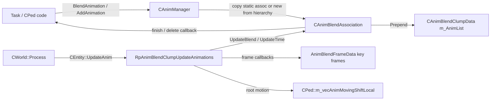

# Animation

How skinned clumps (peds, cutscene objects, animated objects) play animations: the anim blend system built around
`CAnimManager`, `CAnimBlendAssociation` and the RpAnimBlend RenderWare plugin, anim groups and blocks, blending and
callbacks, how tasks start and stop anims, and how IFP blocks are streamed. For who *decides* to play an anim see
[Tasks.md](Tasks.md) ("Template 3: anim callback pattern") and [Peds.md](Peds.md) ("Subsystems that hang off peds"); for the frame order see
[WorldStreamingPools.md](WorldStreamingPools.md). `source/game_sa/Animation/README.md` has a short object-model summary.

All paths are relative to the repo root. Addresses are the ones written in the repo (`RH_*Install` or `// 0xADDR`) and
were checked against the IDB.

---

## 1. Overview

```
 load time                                         run time (per clump)
 ─────────                                         ────────────────────
 ANIM\PED.IFP / *.ifp in IMG                       RpClump
   └─ CAnimManager::LoadAnimFile                     └─ plugin data: CAnimBlendClumpData* (RpAnimBlendClumpGetData)
        ├─ CAnimBlock  ms_aAnimBlocks[180]                 ├─ m_AnimList ──> CAnimBlendAssociation ──> ... (running anims)
        └─ CAnimBlendHierarchy ms_aAnimations[2500]        │                    ├─ m_BlendHier ──> CAnimBlendHierarchy
              └─ CAnimBlendSequence[] (one per bone)       │                    └─ m_BlendNodes[numFrames] (CAnimBlendNode)
 DATA\ANIMGRP.DAT + built-in table                         │                          └─ m_Seq ──> CAnimBlendSequence
   └─ AnimAssocDefinition[139]                             └─ m_FrameDatas[] (AnimBlendFrameData, one per bone/frame)
        └─ CAnimBlendAssocGroup (one per AssocGroupId)
              └─ CAnimBlendStaticAssociation[] (template per AnimationId,
                                                 sequences already mapped to the ped skeleton)
```

- A **hierarchy** is the animation data (key frames per bone). It belongs to a **block** (one IFP file) and lives until
  the block is streamed out.
- A **static association** is a hierarchy pre-bound to a reference clump (`MODEL_MALE01`), stored in a **group**
  (`CAnimBlendAssocGroup`, indexed by `AssocGroupId`). Groups map an `AnimationId` to a static association.
- An **association** (`CAnimBlendAssociation`) is one anim *playing* on one clump: blend amount, blend delta, time,
  speed, flags, callback. It is copied from a static association (by id) or created from a hierarchy (by name).
- The **clump data** (`CAnimBlendClumpData`) is the per-clump list of associations plus one `AnimBlendFrameData` per
  bone. Every frame `RpAnimBlendClumpUpdateAnimations` blends all associations into the bone key frames.



---

## 2. Key classes and files

| Class / file | Role |
|---|---|
| `CAnimManager` (`Animation/AnimManager.h/.cpp`) | All static. Owns hierarchies, blocks, definitions and groups. `AddAnimation`, `BlendAnimation`, `AddAnimationAndSync`, block refs, the uncompressed-anim LRU cache |
| `CAnimBlendAssociation` (`Animation/AnimBlendAssociation.h`, 0x3C, virtual dtor) | Running anim: `m_Link`, `m_NumBlendNodes`, `m_AnimGroupId`, `m_BlendNodes`, `m_BlendHier`, `m_BlendAmount`, `m_BlendDelta`, `m_CurrentTime`, `m_Speed`, `m_TimeStep`, `m_AnimId`, `m_Flags`, callback type/func/data |
| `CAnimBlendStaticAssociation` (`AnimBlendStaticAssociation.h`, 0x14, vtable `0x85C6CC`) | Template per anim in a group: group id, anim id, flags, hierarchy, `m_BlendSeqs` (sequence per clump frame) |
| `CAnimBlendAssocGroup` (`AnimBlendAssocGroup.h`, 0x14) | `m_AnimBlock`, `m_Anims` (static associations), `m_NumAnims`, `m_IdOffset` (first `AnimationId` of the group), `m_GroupID` |
| `CAnimBlendHierarchy` (`AnimBlendHierarchy.h`, 0x18) | Name hash, `m_pSequences`, `m_nSeqCount`, `m_bIsCompressed`, `m_bKeepCompressed`, `m_nAnimBlockId`, `m_fTotalTime`, `m_Link` (LRU cache link) |
| `CAnimBlendSequence` (`AnimBlendSequence.h`, 0xC) | Key frames of one bone (bone tag or name hash), compressed (`int16`) or not, with or without translation |
| `CAnimBlendNode` (`AnimBlendNode.h`, 0x18) | Per association and bone: current/previous key frame, remaining time, `m_Seq`, `m_BlendAssoc` |
| `CAnimBlendClumpData` (`AnimBlendClumpData.h`, 0x14) | `m_AnimList`, `m_NumFrameData`, `m_PedPosition` (root motion target), `m_FrameDatas` |
| `AnimBlendFrameData` (`AnimBlendFrameData.h`, 0x18) | Per bone: flags (`HasVelocity`, `HasZVelocity`, `NeedsKeyFrameUpdate`, `IsCompressed`, ...), bone position, key frame (skinned) or `RwFrame*` (non-skinned), bone tag |
| `CAnimBlock` (`AnimBlock.h`, 0x20) | One IFP: name, `IsLoaded`, `RefCnt`, `FirstAnimIdx`, `NumAnims`, `GroupId` |
| `AnimAssocDefinition` (`AnimationStyleDescriptor.h`, 0x30) | Group definition: group name, block name, model index, anim count, anim names, `AnimDescriptor[]` (id + default flags) |
| RpAnimBlend plugin (`Plugins/RpAnimBlendPlugin/RpAnimBlend.h/.cpp`) | Clump plugin (`ClumpOffset` `0xB5F878`), `RpAnimBlendClumpInit`, association lookups, the per-frame update and frame callbacks |
| Enums (`Enums/AnimationEnums.h`) | `AssocGroupId` (0..138, `ANIM_TOTAL_GROUPS` = 139), `AnimationId` (global ids, `ANIM_ID_WALK` = 0, `RUN`, `SPRINT`, `IDLE` = 3, ...) |
| Group table (`Animation/AnimAssocDefinitions.cpp`, `AnimAssocAnimations.h`, `AnimAssocDescriptions.h`) | Names and descriptors of the 118 built-in groups (`aStdAnimDescs` `0x8A7788`, ...) |

Globals (`AnimManager.h`):

| Global | Address | Notes |
|---|---|---|
| `ms_aAnimAssocDefinitions` | `0x8AA5A8` | Built-in table, 118 entries filled at compile time; room for 145 in the exe |
| `ms_numAnimAssocDefinitions` | `0xB4EA28` | Set to 118 by `Initialise`, 139 after `animgrp.dat` |
| `ms_aAnimAssocGroups` | `0xB4EA34` | `new CAnimBlendAssocGroup[ms_numAnimAssocDefinitions]` in `LoadAnimFiles` |
| `ms_aAnimations` / `ms_numAnimations` | `0xB4EA40` / `0xB4EA2C` | 2500 hierarchies, blocks take contiguous ranges |
| `ms_aAnimBlocks` / `ms_numAnimBlocks` | `0xB5D4A0` / `0xB4EA30` | 180 blocks = streaming ids `RESOURCE_ID_IFP` (25575) .. +179 |
| `ms_AnimCache` | `0xB5EB20` | `CLinkList<CAnimBlendHierarchy*>`, 50 uncompressed hierarchies (LRU) |
| `gpAnimBlendClump` | `0xB4EA0C` | Clump being updated, read by the frame callbacks |

---

## 3. Groups, blocks and anim ids

- **Initialise** (`0x5BF6B0`): counts to 0, `ms_numAnimAssocDefinitions = 118`, cache of 50,
  `ReadAnimAssociationDefinitions` (`0x5BC910`) parses `DATA\ANIMGRP.DAT` and appends the 21 walk-style groups
  (`man`, `shuffle`, `oldman`, ... `skate`, ids 118-138) with `AddAnimAssocDefinition` (`0x4D3BA0`) /
  `AddAnimToAssocDefinition` (`0x4D3C80`), all using `aStdAnimDescs` and `MODEL_MALE01`. Then
  `RegisterAnimBlock("ped")`.
- **LoadAnimFiles** (`0x4D5620`): loads `ANIM\PED.IFP` (always resident), allocates the group
  array and calls `CreateAnimAssocGroups` (`0x4D3CC0`).
- **CreateAnimAssocGroups** (`0x4D3CC0`): for every group whose block is loaded and which has no
  associations yet, creates a temporary instance of the definition's model, `RpAnimBlendClumpInit`, and
  `CreateAssociations(blockName, clump, animNames, numAnims)` (`0x4CE6E0`) builds one static association per anim,
  mapping each sequence to a clump frame. Default flags from the `AnimDescriptor` table are OR-ed in. Called again
  every time a block is streamed in.
- **Ids**: `AnimationId` values are global. A group covers the ids starting at its first descriptor
  (`m_IdOffset = def->AnimDescr->AnimId`) and `GetAnimation(id)` returns `m_Anims[id - m_IdOffset]`. Groups that share a descriptor table (all walk styles use `aStdAnimDescs`) share the
  same ids: `ANIM_ID_WALK` in `ANIM_GROUP_MAN` and in `ANIM_GROUP_DEFAULT` are different hierarchies with the same id.
  A ped's walk style is `CPed::m_nAnimGroup`, from `CPedModelInfo::m_nAnimType`.
- **Blocks**: `RegisterAnimBlock(name)` (`0x4D3E50`) reserves a `CAnimBlock`; `CStreaming::LoadCdDirectory` registers one
  per `.ifp` found in an IMG. `GetAnimationBlockIndex(name)` (`0x4D3990`) is how code finds
  one. `GetFirstAssocGroup(name)` (`0x4D39B0`) gives the first group that uses the block.
- **Named anims** (script `TASK_PLAY_ANIM`, `CTaskSimpleRunNamedAnim`) skip groups: `GetAnimation(name, block)`
  (`0x4D42F0`) finds the hierarchy and `AddAnimation(clump, hier, flags)` / `BlendAnimation(clump, hier, flags, delta)`
  build an association directly from it.

### IFP files

`LoadAnimFile(stream, compressed, uncompressedNames)` (`0x4D47F0`) dispatches on the fourcc:
`ANP2`/`ANP3` (SA format, `LoadAnimFile_ANP23`) or `ANPK` (III/VC format, `LoadAnimFile_ANPK`, written from the
gtamods docs and untested per the comment in `LoadAnimFile_ANPK`). Anims are loaded compressed unless their name is in
`uncompressedNames` (cutscenes pass `CCutsceneMgr::ms_aUncompressedCutsceneAnims`). `RemoveLastAnimFile`
(`0x4D3ED0`) drops the newest block (cutscene anims).

### Compression and the LRU cache

Hierarchies are stored compressed (`int16` key frames). `UncompressAnimation` (`0x4D41C0`) must
be called before an anim is evaluated: if the hierarchy is `m_bKeepCompressed` it only computes the total time; otherwise
it uncompresses it and puts it at the head of `ms_AnimCache`. When the 50 links are used up the least recently used
hierarchy is compressed back (`RemoveUncompressedData` `0x4CF760`). Every `BlendAnimation`, `AddAnimation`,
`CopyAnimation`, `SetCurrentTime` and the per-frame update call it, which keeps playing anims at the head.

---

## 4. Starting, blending and stopping anims

| Call | Address | What it does |
|---|---|---|
| `AddAnimation(clump, group, id)` | `0x4D3AA0` | Copy the static association, sync it with an already running synchronised anim (if both are `ANIMATION_IS_SYNCRONISED`) or `Start(0)`, prepend to the clump list. Blend amount stays 1 |
| `AddAnimation(clump, hier, flags)` | `0x4D4330` | Same from a hierarchy (named anims); references the block |
| `AddAnimationAndSync(clump, syncWith, group, id)` | `0x4D3B30` | Explicit sync partner |
| `BlendAnimation(clump, group, id, delta = 8)` | `0x4D4610` | **The usual entry.** Every other association with the same partial/facial kind gets `ANIMATION_IS_BLEND_AUTO_REMOVE` and a negative blend delta (`min(-0.05, -blend * delta)`, or `-1` if already at 0). If the anim already runs, only its delta is set (`(1 - blend) * delta`) and it restarts if finished; otherwise it is added with blend 0 and delta `delta` (or blend 1 if nothing had to fade out and it is not partial) |
| `BlendAnimation(clump, hier, flags, delta)` | `0x4D4410` | Same for a named hierarchy |
| `CreateAnimAssociation(group, id)` | `0x4D3A40` | Copy only, not added to any clump |
| `RpAnimBlendClumpGetAssociation(clump, id)` | `0x4D68B0` | First association with that `AnimationId` (any group). Overloads by name (`0x4D6870`) and hierarchy (`0x4D68E0`) |
| `RpAnimBlendClumpGetFirstAssociation(clump[, flags])` | `0x4D15E0` / `0x4D6A70` | First (with any of the flags) |
| `RpAnimBlendClumpGetMainAssociation` / `...MainPartialAssociation` | `0x4D6910` / `0x4D69A0` | Highest blend amount (non-partial / partial) |
| `RpAnimBlendClumpSetBlendDeltas(clump, flags, delta)` | `0x4D67E0` | Fade out a set of anims |
| `RpAnimBlendClumpRemoveAssociations(clump, flags)` / `RemoveAllAssociations` | `0x4D6820` / `0x4D6C00` | `delete` immediately (no callbacks, see Gotchas) |
| `RpAnimBlendClumpPauseAllAnimations` / `UnPause...` | `0x4D6B00` / `0x4D6B30` | Clear / set `ANIMATION_IS_PLAYING` |

Association methods (`AnimBlendAssociation.cpp`): `Start(t)` (`0x4CEB70`, sets playing + `SetCurrentTime`),
`SetCurrentTime` (`0x4CEA80`, wraps for looped anims, seeks every node), `SyncAnimation` (`0x4CEB40`, same progress as
another anim), `SetBlend(amount, delta)` (`0x4CEBA0`), `SetBlendTo(amount, delta)` (`0x4CEB80`,
`delta = (amount - current) * delta`), `SetSpeed`, `SetFinishCallback` (`0x4CEBE0`), `SetDeleteCallback` (`0x4CEBC0`).

### Flags (`eAnimationFlags`, `AnimBlendAssociation.h`)

| Flag | Value | Meaning |
|---|---|---|
| `ANIMATION_IS_PLAYING` | 0x1 | Time advances |
| `ANIMATION_IS_LOOPED` | 0x2 | Wraps at the end; otherwise stops on the last frame |
| `ANIMATION_IS_BLEND_AUTO_REMOVE` | 0x4 | `delete` the association once blended out to 0 |
| `ANIMATION_IS_FINISH_AUTO_REMOVE` | 0x8 | At the end set `BLEND_AUTO_REMOVE` and blend delta -4 |
| `ANIMATION_IS_PARTIAL` | 0x10 | Added on top of the main anims (gestures, upper body); blended separately |
| `ANIMATION_IS_SYNCRONISED` | 0x20 | Movement cycle: time is driven by the weighted average length of all synced anims (walk/run/sprint mix) |
| `ANIMATION_CAN_EXTRACT_VELOCITY` / `_X_VELOCITY` | 0x40 / 0x80 | Root translation moves the ped instead of the bone |
| `ANIMATION_WALK`, `0x200`, `DONT_ADD_TO_PARTIAL_BLEND`, `IS_FRONT`, `SECONDARY_TASK_ANIM` | 0x100-0x1000 | Game-defined; names partly uncertain (comments in the header) |
| `ANIMATION_IGNORE_ROOT_TRANSLATION` | 0x2000 | |
| `ANIMATION_REFERENCE_BLOCK` | 0x4000 | This association holds a ref on its block (set by `ReferenceAnimBlock` `0x4CEA50` and the copy constructors) |
| `ANIMATION_FACIAL` | 0x8000 | Facial anims; blended only against other facial anims |

### Callbacks

One callback slot per association (`m_nCallbackType`, `m_pCallbackFunc`, `m_pCallbackData`):

- **Finish** (`SetFinishCallback`): called once by `UpdateTime` (`0x4D13D0`) when a
  non-looped anim reaches its end, then reset to `CDefaultAnimCallback::DefaultAnimCB`. Also called by `UpdateBlend`
  if the association is auto-removed (blended out with `BLEND_AUTO_REMOVE`) before it finished.
- **Delete** (`SetDeleteCallback`): called by `UpdateBlend` (`0x4D1490`) right before
  an auto-remove `delete this`. **Not** called by the destructor (`0x4CECF0`), so not by
  `RpAnimBlendClumpRemoveAllAssociations` or when the clump is destroyed.
- `m_pCallbackData` is a raw `void*`, almost always the task that started the anim.

### How tasks drive anims

The common pattern is `CTaskSimpleAnim` (`Tasks/TaskTypes/TaskSimpleAnim.cpp`, vtable `0x86D504`) and its children
(`CTaskSimpleRunAnim`, `CTaskSimpleRunNamedAnim`, ...):

```cpp
// CTaskSimpleRunAnim::StartAnim (0x61A950)
m_pAnim = CAnimManager::BlendAnimation(ped->GetRpClump(), m_nAnimGroup, m_nAnimId, m_fBlendDelta);
m_pAnim->SetFinishCallback(CTaskSimpleAnim::FinishRunAnimCB, this);   // 0x61A8A0: m_bIsFinished = true, m_pAnim = nullptr
```

- `ProcessPed` returns `m_bIsFinished`.
- `MakeAbortable` (`0x61A790`): sets `BLEND_AUTO_REMOVE`; partial anims get blend delta -4
  (-1000 for `ABORT_PRIORITY_IMMEDIATE`), full-body anims are replaced by blending `ANIM_ID_IDLE` of the ped's group
  back in. For URGENT/IMMEDIATE it resets the callback and forgets `m_pAnim`.
- Destructor (`0x61A6F0`): reset the callback, set `BLEND_AUTO_REMOVE`, blend out at -4 unless
  `m_bHoldLastFrame`.

Peds also manage their movement anims directly: `CPed::SetModelIndex` (`0x5E4880`) calls `RpAnimBlendClumpInit`,
`RpAnimBlendClumpFillFrameArray(clump, m_apBones)`, `AddAnimation(clump, m_nAnimGroup, ANIM_ID_IDLE)` and points
`m_PedPosition` at `m_vecAnimMovingShiftLocal`; `CPed::SetMoveAnim` (`0x5E4A00`) blends walk/run/
sprint. Vehicle enter/exit anims use the vehicle's anim group (`CVehicleAnimGroupData`, see [Vehicles.md](Vehicles.md)).

---

## 5. Per-frame flow

1. `CWorld::Process` calls `CEntity::UpdateAnim()` on every moving entity not flagged for removal (cutscene
   objects in an earlier loop of the same function; `CWorld::ProcessForAnimViewer` is the only other caller in the exe).
2. `CEntity::UpdateAnim` (`0x535F00`): returns unless the RW object is a clump with at least one
   association. Off-screen test (`m_bOffscreen`, `GetIsOnScreen`); step is `CTimer::GetTimeStepInSeconds()`
   (cutscene objects: the non-clipped step, always "on screen"). Calls `RpAnimBlendClumpUpdateAnimations`.
3. `RpAnimBlendClumpUpdateAnimations(clump, step, onScreen)` (`0x4D34F0`):
   1. Set `gpAnimBlendClump`. For each association: `UpdateBlend(step)` (may delete it), `UncompressAnimation`, collect
      its node array (at most 11), and for synchronised anims accumulate `totalTime / speed * blend` and `blend`.
      Any non-synchronised anim sets `IncludePartial`.
   2. `UpdateTimeStep` (`0x4D13A0`): synchronised anims get `hierTime * (totalBlend / weightedTime) * step`, others
      `speed * step`, so all movement anims finish their cycle together.
   3. Frame pass over `m_FrameDatas` with `ForAllFrames` (`0x4CF190`): compressed clumps use
      `FrameUpdateCallBackCompressed(Non)Skinned`; on screen `FrameUpdateCallBack(Non)Skinned` after
      `RpAnimBlendClumpCheckKeyFrames` (`0x4D1570`) if `NeedsKeyFrameUpdate`; off screen `FrameUpdateCallbackNoRender`
      (`0x4D2E10`) and `NeedsKeyFrameUpdate` is set. Each callback blends the nodes of all associations into the
      bone's quaternion/translation, scaling non-partial anims by `1 - partial blend`.
   4. Root motion: frames with `HasVelocity` (the root, set in `RpAnimBlendClumpInit` `0x4D6720`) do not move the bone;
      the translation delta is added to `*m_PedPosition` instead. `HasZVelocity` adds Z too.
   5. `UpdateTime` on every association (finish callbacks, looping, finish auto-remove), then `RwFrameUpdateObjects`.
4. Skinned bone matrices are rebuilt later by `CEntity::UpdateRpHAnim` (`0x532B20`), called from
   `CPed::PreRenderAfterTest` and by bone queries (`CPed::GetBonePosition`).
5. The ped turns the extracted root motion into movement in its own update (`CPed::UpdatePosition` `0x5E1B10` adds the (clamped)
   `m_vecAnimMovingShift - m_vecMoveSpeed` to the move speed, verified in the IDB; still hooked `.Reversed = false`).

---

## 6. Streaming of anim blocks

- Ids: block `i` is streaming model `IFPToModelId(i)` = 25575 + i (`RESOURCE_ID_IFP`, `Streaming.h`).
- **Load**: `CStreaming::ConvertBufferToObject` IFP case calls `LoadAnimFile(stream, true)` and
  `CreateAnimAssocGroups()`, unless nobody needs the block any more.
- **Dependencies**: requesting a model whose `GetAnimFileIndex() != -1` also requests its IFP with
  `STREAMING_KEEP_IN_MEMORY` (`CStreaming::RequestModel`). A DFF whose IFP is not loaded yet is re-requested (in
  `CStreaming::ConvertBufferToObject`); while it loads, the model holds a ref (`AddAnimBlockRef` /
  `RemoveAnimBlockRefWithoutDelete`), and `CAtomicModelInfo`/`CClumpModelInfo` keep one while their RW object exists.
- **Refs**: `AddAnimBlockRef` (`0x4D3FB0`) / `RemoveAnimBlockRef` (`0x4D3FD0`) only change `CAnimBlock::RefCnt`; they
  never load or unload. Associations with `ANIMATION_REFERENCE_BLOCK` hold one ref each.
- **Unload**: `CStreaming::RemoveLeastUsedModel` frees an IFP only when `GetNumRefsToAnimBlock == 0` and no requested
  model needs it; `CStreaming::RemoveModel` then calls `CAnimManager::RemoveAnimBlock` (`0x4D3F40`), which destroys the static associations of every group using the block and shuts down its
  hierarchies.
- **Task pattern** (`CTaskComplexSitDownThenIdleThenStandUp`, `CTaskComplexPartnerGreet::StreamRequiredAnims` `0x6825B0`):

  ```cpp
  const auto idx = CAnimManager::GetAnimationBlockIndex("attractors");
  if (CAnimManager::GetAnimBlocks()[idx].IsLoaded) { CAnimManager::AddAnimBlockRef(idx); m_refAdded = true; }
  else { CStreaming::RequestModel(IFPToModelId(idx), STREAMING_KEEP_IN_MEMORY); }
  // ... destructor / no longer needed:
  if (m_refAdded) CAnimManager::RemoveAnimBlockRef(idx);
  ```

  Do not play an anim from a block you have not referenced: if its ref count drops to 0 the hierarchy can be freed under
  a running association.

---

## 7. Gotchas

- **`RpAnimBlendClumpUpdateAnimations` runs original code.** It is hooked `.Reversed = false`
  ("Unhooked for testing" in the `RpAnimBlend.cpp` `InjectHooks`), so the per-frame blend, the frame callbacks and root motion are
  GTA's. Our `FrameUpdateCallBackT` templates are only used if you enable it.
- **`#ifdef` on a macro defined as 0** (`RpAnimBlend.cpp`): `USE_COPY_PASTE_FRAME_UPDATE` is `0` but tested with
  `#ifdef`, so the copy-pasted R* frame callbacks are compiled and hooked with `HS::RedirectToGTA`, while
  `FrameUpdateCallBackW` tests it with `#if` and uses the templates. Probably meant to be `#if` in both places.
- **The templates fix bugs unconditionally** (`constexpr bool IsFixBugs = true` in `RpAnimBlend.cpp`), not through
  `notsa::bugfixes`. Make it switchable before enabling the update function.
- **Delete callbacks are not called on `delete`.** Only an auto-remove in `UpdateBlend` calls them. A task that keeps an
  association pointer must also survive the clump being destroyed or `RemoveAllAssociations` being called (ped death,
  model change). Reset callbacks to `CDefaultAnimCallback::DefaultAnimCB` in the task destructor and `MakeAbortable`.
- **`BLEND_AUTO_REMOVE` deletes inside the update.** Never keep an association pointer across frames without a finish
  or delete callback that clears it. `BlendAnimation` sets this flag on every anim it fades out.
- **`CDefaultAnimCallback::DefaultAnimCB` is an inline function in our header** (`AnimBlendAssociation.h`), so its
  address differs from the original `0x4D1390`. Never compare `m_pCallbackFunc` against it; the save code that maps
  callbacks to ids (`FindCBFunctionID` `0x59C9E0`, table `CBArray` `0x8D0950`) has no callers in the exe.
- **Lookup by id ignores the group.** `RpAnimBlendClumpGetAssociation(clump, ANIM_ID_WALK)` returns whichever
  `ANIM_ID_WALK` is first in the list, whatever walk style it came from.
- **`m_PedPosition` is a `CVector*` but peds point it at a `CVector2D`** (`m_vecAnimMovingShiftLocal`, set in `CPed::SetModelIndex`). It is safe only
  because peds never get `HasZVelocity`; only cutscene objects set it, and they point it at `m_vecMoveSpeed`
  (`CutsceneObject.cpp`).
- **The replacement table `ms_aAnimAssocDefinitionsX` is unused** (`AnimAssocDefinitions.cpp`); all code reads the
  original `ms_aAnimAssocDefinitions` at `0x8AA5A8`. Edit the exe-side data, not the X table, when testing.
- **`ms_aAnimAssocDefinitions` is declared with 118 entries** (`NUM_ANIM_ASSOC_GROUPS` in `AnimManager.h`) but 139 are used (the exe has room for
  145). Indexing past 118 is out of the declared bounds; widen the type if you add bounds checks.
- **Anim ids are not unique per hierarchy**: groups sharing a descriptor table share ids. Use (group, id) pairs.
- **Facial anims** (`ANIMATION_FACIAL`) only fade against other facial anims in `BlendAnimation(group, id)`, so they are
  never auto-removed by body anims.
- Several flag names are uncertain (header comments). Do not rename them in a reversal PR.
- **Open bug: `CAnimBlendClumpData` frees the wrong pointer.** The destructor (`0x4CF100`) and `SetNumberOfBones`
  (`0x4CF140`) call `CMemoryMgr::FreeAlign(&m_FrameDatas)`. The original passes
  `m_FrameDatas`. `FreeAlign` reads the real block pointer from the word before its argument, which here is
  `m_PedPosition`: the frame array leaks, and for a ped `CMemoryMgr::Free` is called on the address of
  `CPed::m_vecAnimMovingShiftLocal`. Both functions are hooked and active; the destructor runs from `ClumpAnimDestruct`
  (`RpAnimBlend.cpp`) whenever a ped clump is destroyed.
- **Open bug: `CAnimManager::StreamAnimBlock` is inverted** (NOTSA helper replacing the code
  of `CTaskComplexPartnerGreet::StreamRequiredAnims` `0x6825B0`). The original adds a ref / requests the block when it
  *should* be loaded and is not referenced yet, and removes the ref when it should *not* be loaded and is referenced.
  Ours does the opposite (removes a ref it never took, sets `isLoaded = false` in the first branch). Its only caller is
  `CTaskComplexPartnerGreet`.
- **Open bug (minor): `AddAnimAssocDefinition`** (`0x4D3BA0`) does not skip already used slots and
  does not clear the next slot's name (`if (count < 145) defs[count].GroupName[0] = 0` in the original). No effect with
  the stock data, but the logic differs.
- Minor: our `RpAnimBlendClumpUpdateAnimations` returns before setting `gpAnimBlendClump` for an empty list; the
  original sets it first (`0x4D34F0`). Harmless today because the function is not enabled.

---

## 8. What is left

Data from `python .claude/skills/find-reversing-targets/scripts/idb_coverage.py --class <Class>` and
`--scope game --classes 30 --filter Anim`.

| Class | Funcs | Rev | Known | Missing | Bytes left |
|---|---|---|---|---|---|
| `CAnimManager` | 33 | 31 | 1 (`RemoveAnimBlockRef` `0x4D3FD0`) | 1 (`LoadAnimFile(const char*)` `0x4D55D0`) | 89 |
| `CAnimBlendAssociation` | 23 | 20 | 1 (dtor `0x4CECF0`) | 2 (`GetNode` `0x4CEB60`, deleting dtor `0x4CEFA0`) | 140 |
| `CAnimBlendAssocGroup` | 16 | 15 | 0 | 1 (`CreateAssociations(const char*, RpClump*)` `0x4CE5C0`) | 277 |
| `CAnimBlendStaticAssociation` | 8 | 6 | 1 (dtor `0x4CEC00`) | 1 (deleting dtor `0x4CEF30`) | 68 |
| `CAnimBlendClumpData` | 7 | 6 | 0 | 1 (deleting dtor `0x4D5F20`) | 30 |
| `CAnimBlendHierarchy`, `CAnimBlendSequence`, `CAnimBlendNode` | 45 | 45 | 0 | 0 | 0 |
| `CDefaultAnimCallback` | 1 | 0 | 0 | 1 (`DefaultAnimCB` `0x4D1390`, empty) | 1 |
| **Total (9 classes)** | **133** | **123 (92.5%)** | **3** | **7** | **~0.6 KB** |

RpAnimBlend plugin (free functions, not in the class count): 38 hooked and active (`InjectHooks` at the end of `RpAnimBlend.cpp`),
`RpAnimBlendClumpUpdateAnimations` hooked `.Reversed = false`, 4 frame callbacks hooked but redirected to GTA, 6
velocity-extraction callbacks (`0x4D1680`-`0x4D27F0`, about 5.3 KB) reimplemented as templates but not hookable (they
take arguments in `eax`), `RpAnimBlendClumpInitSkinned` (`0x4D6510`, `eax` argument), `RpAnimBlendClumpCheckKeyFrames`
(`0x4D1570`) and `FrameUpdateCallbackNoRender` (`0x4D2E10`) KNOWN, `RpAnimBlendClumpInitNonSkinned` (`0x4D66A0`)
MISSING.

Consumers with anim work left (same `--filter Anim` run): `CTaskComplexPlayHandSignalAnim` (1,050 bytes),
`CTaskSimpleRunNamedAnim` (870, 3 stubs incl. `ProcessPed` `0x61BF20`), `CTaskSimpleRunAnimLoopedMiddle` (870,
untouched), `CTaskSimpleAnim` (252), `CTaskSimplePlayHandSignalAnim` (230), `CTaskSimpleHandsignalAnim` (146),
`CTaskSimpleRunAnim` (77).

Priorities:

1. **Fix `CAnimBlendClumpData::~CAnimBlendClumpData` / `SetNumberOfBones`** (`FreeAlign(m_FrameDatas)`): active
   memory corruption on every ped clump destruction.
2. **Fix `CAnimManager::StreamAnimBlock`** to match `0x6825B0`, or inline the original logic back into
   `CTaskComplexPartnerGreet::StreamRequiredAnims`.
3. **Enable `RpAnimBlendClumpUpdateAnimations`** (`0x4D34F0`, 644 bytes): validate against the IDB (order of passes,
   `gpAnimBlendClump`, node array limit 11), make `IsFixBugs` a `notsa::bugfixes` switch, decide `#if` vs `#ifdef` for
   the copy-paste callbacks, then write a difftest (step one ped clump with a walk/run blend and compare bone key
   frames and `m_vecAnimMovingShiftLocal` with ULP tolerance).
4. **`CAnimBlendAssocGroup::CreateAssociations(const char*, RpClump*)`** (`0x4CE5C0`, 277 bytes): the commented-out
   install in `CAnimBlendAssocGroup::InjectHooks`.
5. **`CTaskSimpleRunNamedAnim`** (`ProcessPed`, `Clone`, `GetTaskType` stubs, `StartAnim` `0x61BB10` and
   `FinishRunAnimMovePedCB` `0x61AAA0` commented out) - the script `TASK_PLAY_ANIM` path.
6. Small items: hook `RemoveAnimBlockRef` (`0x4D3FD0`, identical body to `RemoveAnimBlockRefWithoutDelete`),
   `LoadAnimFile(const char*)` (`0x4D55D0`), destructors, `RpAnimBlendClumpInitNonSkinned`.

For each target use `class_dossier.py <Class>`, then [../ReversingGuide.md](../ReversingGuide.md) and
`/validate-against-binary`.
