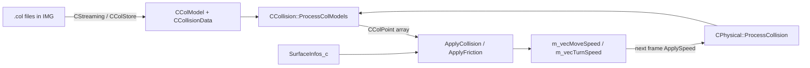

# Collision and physics

How the game finds contacts between entities (`CCollision`, col models, col files) and how it turns them into motion
(`CPhysical`, the `CWorld::Process` collision loop, surfaces, buoyancy). For the world grid, sector lists and the frame
order around this see [WorldStreamingPools.md](WorldStreamingPools.md); for vehicle-specific physics (wheels,
suspension) see [Vehicles.md](Vehicles.md); for collision events given to peds see [Events.md](Events.md).

All paths are relative to the repo root. Addresses are the ones written in the repo (`RH_*Install` or `// 0xADDR`) and
were checked against the IDB.

---

## 1. Overview

There are two halves, in two folders:

- **Geometry** (`source/game_sa/Collision/`): col models made of spheres, boxes, lines and triangles, and the static
  `CCollision` functions that test them against each other. No knowledge of mass or speed.
- **Response** (`source/game_sa/Entity/Physical.cpp`): `CPhysical` holds speeds and masses, asks `CCollision` for
  contact points and applies impulses, friction and shifts. Called once per moving entity from `CWorld::Process`.

```
CWorld::Process (0x5684A0)
  ├─ CEntity::UpdateAnim            (animation, see Animation.md)
  ├─ entity->ProcessControl()       CPhysical::ProcessControl: friction, gravity, air resistance
  ├─ entity->ProcessCollision()     x 1 + 4 (+1 "stuck" pass)
  │     CPhysical::ProcessCollision -> ApplySpeed -> CheckCollision
  │        └─ ProcessCollisionSectorList(x, y)   per sector touched by the bounding rect
  │              └─ ProcessEntityCollision(other)  -> CCollision::ProcessColModels -> CColPoint[32]
  │              └─ ApplyCollision / ApplySoftCollision / ApplyFriction  (impulses)
  └─ entity->ProcessShift()         x 2 (bSecondShift false/true) - push out of overlaps
        └─ ProcessShiftSectorList -> move position along the summed normals
```



---

## 2. Key classes and files

| Class / file | Role |
|---|---|
| `CCollision` (`Collision/Collision.h/.cpp`, ~3,800 lines) | All static. `Test*` (bool) and `Process*` (fills a `CColPoint`) for every shape pair, `ProcessColModels`, line of sight, vertical lines, camera sphere casts, the triangle-plane cache |
| `CColModel` (`Collision/ColModel.h`, 0x30) | Bounding box (`CBoundingBox`, 0x18) + bounding sphere (`CSphere`, 0x10) + `m_nColSlot` + flags + `CCollisionData* m_pColData` |
| `CCollisionData` (`Collision/CollisionData.h`, 0x30) | Counts and pointers to the shapes. Span helpers `GetSpheres()`, `GetBoxes()`, `GetTris()`, `GetTriPlanes()`, `GetLines()`, `GetShdwTris()` |
| `CColSphere` (0x14), `CColBox` (0x1C), `CColLine` (0x20), `CColDisk` (0x24), `CColTriangle` (0x8), `CColTrianglePlane` (0xA) | Shapes. Spheres/boxes carry a `CColSurface` (material, piece, lighting, light; 4 bytes). Triangles index into the vertex array |
| `CColPoint` (`Collision/ColPoint.h`, 0x2C) | One contact: `m_vecPoint` (0x0), `m_vecNormal` (0x10), surface/piece/lighting for A (0x20-0x22) and B (0x23-0x25), `m_fDepth` (0x28) |
| `CompressedVector` (`CompressedVector.h`) | `FixedVector<int16, 128.0f>`: col vertices are stored as int16 / 128 (about 0.008 m resolution, +-256 m range) |
| `CColStore` (`Collision/ColStore.h/.cpp`) | Streams col files: one `ColDef` (0x2C) per `.col` in a pool of 255 slots (`ms_pColPool`, `0x965560`). Ref-counts and area tests |
| `CColAccel` (`Collision/ColAccel.h/.cpp`) | Start-up cache `MODELS\CINFO.BIN` for col bounds and IPL entries (dormant in PC 1.0, see Gotchas) |
| `CTempColModels` (`Collision/TempColModels.h/.cpp`) | Built-in col models (`ms_colModelBBox` `0x968A00`, peds `ms_colModelPed1` `0x968DF0`, doors, bumpers, ...). `Initialise` `0x5BA8C0` |
| `CPhysical` (`Entity/Physical.h/.cpp`, 0x138, vtable `0x863BA0`, 23 slots) | Speeds, masses, forces, collision response, sector-list membership |
| `CWorld` (`World.cpp`) | `Process` (`0x5684A0`) runs the collision loop; `ProcessLineOfSight`, `ProcessVerticalLine`, `TestSphereAgainstWorld` and friends walk sector lists and call `CCollision` |
| `SurfaceInfos_c` (`SurfaceInfos_c.h/.cpp`, 0x8F4, global `g_surfaceInfos` `0xB79538`) | Per-material properties from `surfinfo.dat`, `surfaud.dat` and the adhesion table from `surface.dat` |
| `cBuoyancy` (`Buoyancy.h/.cpp`, 0xD0, global `mod_Buoyancy` `0xC1C890`) | Water force for peds, objects, cars, bikes and boats |
| `CCollisionEventScanner` (`Collision/CollisionEventScanner.h`) | Turns a ped's collision records into AI events (NOHOOK stub, see section 10) |

---

## 3. Col models

### 3.1 Layout (`CollisionData.h`)

```
CColModel (0x30)                       CCollisionData (0x30)
  0x00 CBoundingBox m_boundBox           0x00 uint16 m_nNumSpheres, m_nNumBoxes, m_nNumTriangles
  0x18 CSphere      m_boundSphere        0x06 uint8  m_nNumLines, flags (bUsesDisks, bHasFaceGroups, bHasShadowInfo)
  0x28 uint8        m_nColSlot           0x08 CColSphere*  m_pSpheres
  0x29 uint8        flags                0x0C CColBox*     m_pBoxes
       (m_bHasCollisionVolumes,          0x10 CColLine*    m_pLines   (union with CColDisk* m_pDisks)
        m_bIsSingleColDataAlloc,         0x14 CompressedVector* m_pVertices
        m_IsActive)                      0x18 CColTriangle*      m_pTriangles
  0x2C CCollisionData* m_pColData        0x1C CColTrianglePlane* m_pTrianglePlanes   (lazy, separate allocation)
                                         0x20 ... shadow mesh: num, m_pShadowVertices (0x28), m_pShadowTriangles (0x2C)
```

- A col model loaded from a file is a **single allocation** (`m_bIsSingleColDataAlloc`): the `CCollisionData` header and
  all shape arrays live in one buffer. `CColModel::MakeMultipleAlloc` (`0x40F740`) splits it so arrays can be resized.
- **Face groups**: if `bHasFaceGroups` is set, a `uint32` count and a `FaceGroup[]` array sit right *before*
  `m_pTriangles`, with no pointer to them (long comment in `CollisionData.h`). Only valid for single-allocation models.
- **Triangle planes** (`CColTrianglePlane`: compressed normal + distance + orientation) are computed on demand by
  `CCollision::CalculateTrianglePlanes(CCollisionData*)` (`0x416330`). The computed planes are kept
  in an LRU cache `ms_colModelCache` (`0x96592C`, 50 links, `CCollision::Init` `0x416260`). When the cache is full the
  least recently used model loses its planes (`RemoveTrianglePlanes`). Any code that reads `m_pTrianglePlanes` must call
  `CalculateTrianglePlanes` first, as `ProcessLineOfSight` does.
- `m_pLines` and `m_pDisks` share storage. `bUsesDisks` is always false in SA files; `ProcessColModels` skips the disk
  code (see the comment in `ProcessColModels`). Vehicles use the lines as wheel suspension rays (see the ghost branch of
  `CPhysical::ProcessCollision`, and "Wheels, suspension and colpoints" in [Vehicles.md](Vehicles.md)).

### 3.2 Compressed vectors

`CompressedVector` is `FixedVector<int16, 128.0f>` (`CompressedVector.h`). Use its conversions (`CVector{cv}`,
`CompressedVector{v}`), not the `[[deprecated]]` `CompressVector`/`UncompressVector` helpers. Other fixed-point flavours
in the same header: `CompressedLargeVector` (/8), `CompressedUnitVector` (/4096), `CompressedFxVector` (/32767).
`CCollisionData::GetTrianglePoint` (`0x40F5E0`) and `GetShadTrianglePoint` (`0x40F640`) return uncompressed corners.

### 3.3 Col files (`FileLoader.cpp`, `Collision/ColHelpers.h`)

- Format per model: `FileHeader` (fourcc `COLL`/`COL2`/`COL3`/`COL4`, size, 22-char name, model id), then a version
  specific header (`ColHelpers.h`, structs `TSphere`, `TBox`, `TFace`, `TVertex`...).
- `CFileLoader::LoadCollisionFile(uint8*, uint32, uint8 colId)` (`0x538440`) walks a buffer that
  holds many models, finds the model info by id or by name inside the `ColDef`'s model range, creates a `CColModel` if
  needed and dispatches to `LoadCollisionModel` (COLL), `LoadCollisionModelVer2` (`0x537EE0`), `Ver3` (`0x537CE0`),
  `Ver4` (`0x537AE0`). It sets `m_nColSlot = colId`.
- `LoadCollisionFileFirstTime` (`0x5B5000`) is used while the level loads to fill the `ColDef` bounds.
- The `COLFILE` line of `gta.dat` loads a col file directly (`CFileLoader::LoadLevel`).

### 3.4 Streaming: `CColStore`

- One `ColDef` per `.col` (`ColStore.h`): `m_Area` (bounds of everything in it), name, model id range
  (`m_nModelIdStart/End`), ref count, `m_bActive`, `m_bCollisionIsRequired`, `m_bProcedural`, `m_bInterior`.
- Col files live in the streaming id range `RESOURCE_ID_COL` (25000, 255 ids, `Streaming.h`).
- `CColStore::LoadCollision(pos, bIgnorePlayerVeh)` (`0x410860`) and `EnsureCollisionIsInMemory(pos)` (`0x410AD0`) are
  called from `CStreaming::Update` around the player (and around the vehicle being removed); they request/remove col files whose
  `m_Area` is near the position. `SetCollisionRequired` / `AddCollisionNeededAtPosn` let scripts and interiors force
  collision at another point (e.g. `CEntryExit` before a teleport).
- `CCollision::SortOutCollisionAfterLoad` (`0x411E30`) loads collision around the camera after a save is loaded.
- `CCollision::Update` (`0x411E20`) is empty but still called from the main loop.

---

## 4. `CCollision`: Test versus Process

| Kind | Signature pattern | Contract |
|---|---|---|
| `Test*` | `bool TestAB(const A&, const B&)` | Only says whether they touch. No output, no early-out state |
| `Process*` | `bool ProcessAB(const A&, const B&, CColPoint& out, float& maxTouchDistance)` | Fills `out` **only if** the contact is closer than `maxTouchDistance` (or deeper than the current depth for sphere pairs), then shrinks `maxTouchDistance`. Call it repeatedly with the same float to keep the nearest hit |

Shape pairs (addresses from `CCollision::InjectHooks`):

| Pair | Test | Process |
|---|---|---|
| sphere-sphere | `TestSphereSphere` `0x411E70` | `ProcessSphereSphere` `0x416450` |
| sphere-box | `TestSphereBox` `0x4120C0` | `ProcessSphereBox` `0x412130` |
| sphere-triangle | `TestSphereTriangle` `0x4165B0` | `ProcessSphereTriangle` `0x416BA0` |
| line-sphere | `TestLineSphere` `0x417470` | `ProcessLineSphere` `0x412AA0` |
| line-box | `TestLineBox` `0x413070`, `TestLineBox_DW` `0x412C70`, `TestVerticalLineBox` `0x413080` | `ProcessLineBox` `0x413100` |
| line-triangle | `TestLineTriangle` `0x413AC0` | `ProcessLineTriangle` `0x4140F0`, `ProcessVerticalLineTriangle` `0x4147E0` |
| disk | - | `ProcessDiscCollision` `0x413960` (unused by SA data) |

Model level:

- **`ProcessColModels`** (`0x4185C0`): A's bounding sphere is moved into B's space and tested
  against B's box; then A's spheres against B's spheres/boxes/triangles, B's spheres against A's triangles, and A's
  lines against B's spheres/boxes/triangles (matrix in the doc comment above `ProcessColModels`). Box-box and
  triangle-triangle are **not** supported (`s_DebugSettings` table in `Collision.h`). Returns the number of sphere
  colpoints, at most 31: each accepted contact also writes `m_fDepth = -1` into the next slot, so the 32-slot array
  must keep one spare. Line results go to `lineCPs` with per-line `maxTouchDistances` (wheels).
  Buffer sizes in our code: 128 spheres, 64 boxes, 600 triangles colliding with the other
  bounding box, 16 lines.
- **Line of sight**: `TestLineOfSight` (`0x417730`), `ProcessLineOfSight` (`0x417950`) and
  `ProcessVerticalLine` (`0x417BF0`) transform the line into model space, test the bounding box, then spheres, boxes and
  triangles. `doSeeThroughCheck` / `doShootThroughCheck` skip materials that `g_surfaceInfos` marks as see/shoot-through.
  `ProcessVerticalLine` can cache the hit triangle in a `CStoredCollPoly` (checked by
  `IsStoredPolyStillValidVerticalLine` `0x414D70`) so peds standing still do not re-test the ground.
- **World queries** walk sector lists: `CWorld::ProcessLineOfSight`, `ProcessVerticalLine`, `GetIsLineOfSightClear`,
  `TestSphereAgainstWorld` (all in `World.cpp`), each calling the `*SectorList` templates.
- **Camera**: `CameraConeCastVsWorldCollision` (`0x41B000`) builds a cache of nearby polys
  (`BuildCacheOfCameraCollision` `0x41AC40`, `CheckCameraCollisionBuildings/Vehicles/Objects/Peds`) and sphere-casts
  against it (`SphereCastVsCaches` `0x4181B0`, `SphereCastVsEntity` `0x419F00`). Used by `CCam`, see [Camera.md](Camera.md).

---

## 5. `CPhysical`

### 5.1 State (`Physical.h`)

| Field | Meaning |
|---|---|
| `m_vecMoveSpeed`, `m_vecTurnSpeed` | Linear speed (units per time step, not per second) and angular speed (axis * rad per step) |
| `m_vecFrictionMoveSpeed`, `m_vecFrictionTurnSpeed` | Friction impulses gathered during collision; added to the speeds at the start of the next `ProcessControl` (`ApplyFriction()` `0x5483D0`) |
| `m_vecForce`, `m_vecTorque` | Present but cleared only; the game applies impulses directly to the speeds |
| `m_fMass`, `m_fTurnMass` | Mass and moment of inertia (scalar). Peds get `70.0` (`CPed` constructor); vehicles and objects set theirs from their data files |
| `m_fAirResistance` | `<= 0.1` (or any vehicle): quadratic drag `speed *= (1 - |v| * k)^step`; otherwise a per-step multiplier (`ApplyAirResistance` `0x544C40`) |
| `m_fElasticity` | Restitution used by `ApplyCollision*`. Temporarily scaled by `HIGHSPEED_ELASTICITY_MULT_COPCAR` (`0x8CD784`) for cop cars in `ProcessCollision` |
| `m_fBuoyancyConstant` | Passed to `cBuoyancy::ProcessBuoyancy` |
| `m_vecCentreOfMass` | Model-space offset; most force functions transform it with the matrix unless `bInfiniteMass` |
| `m_pCollisionList` (`CEntryInfoList`) | One `CEntryInfoNode` per repeat-sector list the entity is in |
| `m_pMovingList` | Node in `CWorld::ms_listMovingEntityPtrs` (`0xB9ACC8`) |
| `m_apCollidedEntities[6]`, `m_nNumEntitiesCollided` | Filled by `AddCollisionRecord` (`0x543490`) when `bCanBeCollidedWith` |
| `m_pDamageEntity`, `m_fDamageIntensity`, `m_nPieceType`, `m_vecLastCollision*` | Strongest hit this frame (`SetDamagedPieceRecord` `0x5428C0`) |
| `m_nContactSurface`, `m_fContactSurfaceBrightness` | Surface under the entity |
| `m_pAttachedTo`, `m_vecAttachOffset`, `m_qAttachedEntityRotation` | Attachment, positioned by `PositionAttachedEntity` (`0x546FF0`) from `CWorld::ProcessAttachedEntities` |
| `m_pEntityIgnoredCollision` | One entity this physical does not collide with (cleared once they stop touching) |

Mass helpers: `GetMass(pos, dir)` is the effective mass at a point along a direction,
`1 / (|pos x dir|^2 / turnMass + 1 / mass)`. Flags that freeze motion: `bInfiniteMass`, `bDisableMoveForce`,
`bDisableTurnForce`, `bDisableZ` (snooker balls: `ApplySpeed` clamps them to `CWorld::SnookerTableMin/Max`).
`IsImmovable()` tests the usual trio.

### 5.2 Force and speed primitives

| Function | Address | Does |
|---|---|---|
| `ApplyMoveForce(CVector)` | `0x5429F0` | `moveSpeed += f / mass` (z zeroed if `bDisableZ`) |
| `ApplyTurnForce(force, point)` | `0x542A50` | `turnSpeed += (point - CoM) x force / turnMass` |
| `ApplyForce(force, point, updateTurn)` | `0x542B50` | Both at once; with `bInfiniteMass` the turn mass grows by `CoM.z^2 * mass / 2` |
| `ApplyFrictionMoveForce` / `ApplyFrictionForce` | `0x5430A0` / `0x543220` | Same, into the friction speeds |
| `GetSpeed(point)` | `0x542CE0` | Velocity of a world point (move + turn x r, friction included) |
| `ApplyMoveSpeed` / `ApplyTurnSpeed` | `0x542DD0` / `0x542E20` | Integrate one time step into the matrix. `ApplyTurnSpeed` rotates the three axes and corrects the position so the CoM stays put |
| `ApplySpeed` | `0x547B80` | `ApplyMoveSpeed` + `ApplyTurnSpeed`, plus the snooker-table and door-hinge special cases (doors stop at +-108 degrees and set `bDoorHitEndStop`) |
| `ApplyGravity` | `0x542FE0` | `moveSpeed.z -= 0.008 * step` (as a force at the CoM if `bInfiniteMass`) |
| `ApplyAirResistance` | `0x544C40` | See table above; `CCullZones::DoExtraAirResistanceForPlayer` multiplies by `CVehicle::m_fAirResistanceMult` |
| `ApplySpringCollision(Alt)`, `ApplySpringDampening` | `0x543C90`, `0x543D60`, `0x543E90` | Suspension springs (vehicles) |

### 5.3 Virtual entry points (vtable `0x863BA0`)

| Slot | Function | Address |
|---|---|---|
| 2 | `Add` | `0x544A30` (STUB) |
| 3 | `Remove` | `0x5424C0` |
| 9 | `GetBoundRect` | `0x5449B0` (bounding sphere radius around the bound centre) |
| 10 | `ProcessControl` | `0x5485E0` |
| 11 | `ProcessCollision` | `0x54DFB0` |
| 12 | `ProcessShift` | `0x54DB10` |
| 13 | `TestCollision` | `0x54DEC0` |
| 22 | `ProcessEntityCollision(CEntity*, CColPoint*)` | `0x546D00` (CPhysical's own virtual; overridden by `CPed`, `CAutomobile`, `CBike`, `CMonsterTruck`, `CTrailer`) |

`CEntity` also declares two virtuals used here: `SpecialEntityPreCollisionStuff` (decides whether a pair
collides, is soft, or is ignored; overridden by `CPed`, `CVehicle`, `CObject`) and `SpecialEntityCalcCollisionSteps`
(number of sub-steps for fast movers).

### 5.4 `ProcessControl` (`0x5485E0`)

Clears `bSubmergedInWater` (non-peds), hit-wall/postponed/safe/contacted flags. If the status is not `STATUS_SIMPLE`:
clears `bOnSolidSurface`, `bDoorHitEndStop`, the collided list and the damage record, calls `ApplyFriction()` (adds the
friction speeds of last frame), then `ApplyGravity()` and `ApplyAirResistance()` unless attached (attached entities with
`bInfiniteMass` still get them). Subclasses call it from their own `ProcessControl` (`CAutomobile`,
`CObject`, `CBoat`, ...). `SkipPhysics` (`0x5433B0`) is the "do nothing this frame" variant.

### 5.5 `ProcessCollision` (`0x54DFB0`)

1. `STATUS_SIMPLE`: only `CheckCollision_SimpleCar` (`0x54DAB0`); if it hits, switch to real physics
   (`CCarCtrl::SwitchVehicleToRealPhysics`). Then `RemoveAndAdd` and return.
2. `STATUS_GHOST` (vehicle on a ghost road): wheels are placed on `CCarCtrl::FindGhostRoadHeight` without any
   collision test.
3. Otherwise ask `SpecialEntityCalcCollisionSteps` for N steps. Optionally pre-check the full move with collision
   disabled (`bForceHitReturnFalse`). For each sub step `i < N`: set the time step to `i * step / N`, `ApplySpeed`,
   `CheckCollision`, restore the matrix; stop at the first hit.
4. Full step: `ApplySpeed`, `Reorthogonalise`, and `CheckCollision` if the entity moves, is a player, a car-park
   vehicle, a ped that is not standing, or has `bProcessCollisionEvenIfStationary`. On a hit the old matrix is
   restored and the entity stays **not** in a safe position, so `CWorld::Process` calls it again.
5. No hit: `SetIsInSafePosition(true)`, `m_fMovingSpeed = distance moved`, `RemoveAndAdd()`.

`CheckCollision` (`0x54D920`) advances the scan code and calls `ProcessCollisionSectorList` for every
sector under `GetBoundRect()`. For peds it first clears `m_standingOnEntity`/`bIsStanding` (the sector pass sets them
again) and sets `bSkipLineCol` while the player is climbing.

### 5.6 `ProcessCollisionSectorList` (`0x54BA60`)

For each entity in the sector's lists (see Gotchas for the order) that uses collision, is not `this` and whose scan
code is not current:

1. Bounding sphere overlap (`GetIsTouching`). If not touching, clear a stale `m_pEntityIgnoredCollision` on either side.
2. Decide the pair: buildings by flags (`bDisableCollisionForce`, attachment, ignored entity, `bDontCollideWithFlyers`);
   physicals by `SpecialEntityPreCollisionStuff`, which returns `collisionDisabled`, `collidedEntityCollisionIgnored`,
   `collidedEntityUnableToMove` (treat it like a building) and `thisOrCollidedEntityStuck` (use soft collision).
3. `ProcessEntityCollision(entity, colPoints)` (`0x546D00`): `CCollision::ProcessColModels` into the static array
   `colPoints[32]` at `0xB73710`, `AddCollisionRecord` on both, `SetHasHitWall` for buildings/static entities.
4. Response per colpoint:
   - vs building / static / unable-to-move: `ApplyCollisionAlt` (`0x544D50`) accumulates move/turn changes, or
     `ApplySoftCollision` (`0x543890`) for stuck entities and pieces 13-16; then `ApplyFriction(friction, cp)`
     (`0x5454C0`), `SetDamagedPieceRecord`, `AudioEngine.ReportCollision`.
   - vs another physical: `ApplyCollision(entity, cp, thisDmg, otherDmg)` (`0x548680`, 744 lines) or
     `ApplySoftCollision(physical, ...)` (`0x54A2C0`), then the two-body `ApplyFriction` (`0x545980`).
   - Objects get `ObjectDamage` with `CPhysical::fxDirection` (`0xB73720`, which is `colPoints[0].m_vecNormal`).
5. Return `true` (hit) so the caller restores the matrix, unless `CWorld::bSecondShift`, in which case keep going.

`bForceHitReturnFalse` turns the whole thing into a pure test (`TestCollision` `0x54DEC0` uses it).
`CWorld::bNoMoreCollisionTorque` stops vehicles getting extra turn impulse after the first collision pass
(checked in `ApplyCollision`, `ApplySoftCollision` and `ProcessCollisionSectorList`).

### 5.7 `ProcessShift` (`0x54DB10`)

Run on entities still not in a safe position after the collision passes. `ApplySpeed`, then for every sector
`ProcessShiftSectorList` (`0x546670`): sum the normals of all colpoints with positive depth (pieces
13-16 excluded), keep the deepest depth, normalise the sum if longer than 1 and move the entity by
`normal * depth * 1.5` (peds: `normal * clamp(1.5 * depth, 0.005, 0.3)`, downward normals: `* 0.75`). Vehicles also get
`0.008 * step` of that normal added to their move speed. After shifting, the entity is checked again with
`ProcessCollisionSectorList`. Speeds are damped by `PHYSICAL_SHIFT_SPEED_DAMP^step` (`0x8CD788`, 0.707) on the second
shift or for peds standing on a moving entity.

### 5.8 Sector lists and `RemoveAndAdd`

- A physical is in the repeat-sector list matching its type (`Vehicles`, `Peds`, `Objects` in `CRepeatSector`,
  `RepeatSector.h`) for every sector its `GetBoundRect()` touches. `m_pCollisionList` keeps one `CEntryInfoNode` per
  membership so `Remove` can unlink them without a search.
- `RemoveAndAdd` (`0x542560`) is called at the end of every `ProcessCollision`/`ProcessShift`: it
  reuses existing nodes for the new sectors (unlink + relink) and deletes the leftovers. Big buildings use plain
  `CEntity::Remove/Add`.
- `AddToMovingList` (`0x542800`) / `RemoveFromMovingList` (`0x542860`): membership in `ms_listMovingEntityPtrs`.
  `CWorld::Process` drops entities that became static after `ProcessControl`.

---

## 6. Per-frame flow: `CWorld::Process` collision part (`0x5684A0`)

Verified against the IDB.

1. `UpdateAnim()` on every moving entity not flagged for removal.
2. `ProcessControl()` on every moving entity; removed entities are deleted, static ones leave the moving list. Second
   pass with `bForceProcessControl = true` for `GetWasPostponed()` entities.
3. `CObject::ProcessControlLogic` for `ms_listObjectsWithControlCode`.
4. Replay playback: only mark everything safe and update RW matrices. Otherwise:
5. `bNoMoreCollisionTorque = false`, one `ProcessCollision()` pass on entities not in a safe position, then
   `bNoMoreCollisionTorque = true` and **4 more passes**. Each call is followed by `UpdateRwMatrix` +
   `UpdateRwFrame`.
6. "Stuck" pass: entities still unsafe get `SetIsStuck(true)` *before* one more `ProcessCollision()`, and again if they
   are still unsafe after it.
7. `bSecondShift = false`, `ProcessShift()` pass; `bSecondShift = true`, second `ProcessShift()` pass.
   After the second pass a player-status entity that is still stuck gets `moveSpeed *= 0.707^step` and one more
   `ApplyMoveSpeed`/`ApplyTurnSpeed`.
8. `CVehicleRecording::SaveOrRetrieveDataForThisFrame`, `g_ikChainMan.Update`, `ProcessAttachedEntities`, then
   `CPedIntelligence::ProcessAfterProcCol` and attached-ped positioning for every moving ped.

The "safe position" flag (`m_bIsInSafePosition`, entity flag `0x20`) is what decides whether an entity takes part in a
pass: `ProcessControl` clears it, a collision-free `ProcessCollision` or `ProcessShift` sets it.

---

## 7. Surfaces: `SurfaceInfos_c`

- `eSurfaceType` (`Enums/eSurfaceType.h`, 0 = `SURFACE_DEFAULT` ... 178 = `SURFACE_RAILTRACK`, so
  `TOTAL_NUM_SURFACE_TYPES` = 179; audio-only `AE_SURFACE_TYPE_*` values start at 188) is the
  material id stored in `CColSurface::m_nMaterial`, `CColTriangle::m_nMaterial` and copied to
  `CColPoint::m_nSurfaceTypeA/B`.
- `SurfaceInfos_c::Init` (`0x55F420`) calls `LoadAdhesiveLimits` (`data\surface.dat`, 6x6 table indexed by adhesion
  group), `LoadSurfaceInfos` (`data\surfinfo.dat`) and `LoadSurfaceAudioInfos` (`data\surfaud.dat`).
- Accessors (`0x55E5C0`-`0x55EB50`, all hooked): `GetAdhesionGroup`, `GetTyreGrip`, `GetWetMultiplier`,
  `GetSkidmarkType`, `GetFrictionEffect`, `GetBulletFx`, `IsSoftLanding`, `IsSeeThrough`, `IsShootThrough`, `IsSand`,
  `IsWater`, `IsShallowWater`, `IsBeach`, `IsSteepSlope`, `IsGlass`, `IsStairs`, `IsSkateable`, `IsPavement`,
  `GetRoughness`, `GetFlammability`, `CreatesSparks`, `CantSprintOn`, ... `IsAudio*`, `CanClimb`.
- `GetAdhesiveLimit(CColPoint*)` (`0x55EB50`) = `m_adhesiveLimits[groupB][groupA]`; vehicles use it for tyre grip,
  `ApplyFriction` for sliding.

---

## 8. Buoyancy: `cBuoyancy`

Single global `mod_Buoyancy` (`0xC1C890`). Callers: `CPed::ProcessBuoyancy`, `CObject::ProcessControl`,
`CAutomobile::ProcessBuoyancy`, `CBike::ProcessBuoyancy` and `CTrain`; boats use `ProcessBuoyancyBoat` (`0x6C3030`,
called from `CVehicle`).

`ProcessBuoyancy(entity, buoyancy, &turnPoint, &force)` (`0x6C3EF0`):

1. `CWaterLevel::GetWaterLevel` at the entity position; no water -> `false`.
2. `PreCalcSetup` (`0x6C2B90`): copies the matrix, builds a slightly shrunk bounding box and centre offsets.
3. Peds: immersion `(waterZ - z + 1) / 1.9` clamped to [0,1], splash particles while partly submerged. Others:
   `SimpleCalcBuoyancy` (`0x6C3B00`) samples up to 9 points of the box with `FindWaterLevel`/`FindWaterLevelNorm` and
   averages them (`SimpleSumBuoyancyData` `0x6C2970`, state in `calcStruct` `0xC1C858`).
4. `CalcBuoyancyForce` (`0x6C2750`) returns the upward force and the point to apply it; the caller applies it with
   `ApplyMoveForce`/`ApplyTurnForce` and sets `bTouchingWater`/`bSubmergedInWater`.

Boats weight the 3x3 sample grid with per-type tables (`afBoatVolumeDistribution*`, `0x8D32CC`-`0x8D335C`).

---

## 9. Gotchas

- **`CCollision` hooks are installed but redirected to GTA.** `CCollision::InjectHooks` sets
  `state = HS::RedirectToGTA` and `Locked` for all `Test*`/`Process*` functions ("Hooks disabled due to bad
  performance in debug mode"). The coverage tool counts them as REVERSED, but at run time the original code runs unless
  you flip them in the debug UI. Validate changes there with a difftest, not by playing.
- **`CPhysical::Add` and `RemoveAndAdd` run original code** (`.Reversed = false` in `CPhysical::InjectHooks`). `Add`'s body is
  `#if 0`; `RemoveAndAdd` is written but not enabled. When you debug sector membership you are in GTA's code.
- **Speeds are per time step.** `m_vecMoveSpeed` is multiplied by `CTimer::GetTimeStep()` (1.0 at 50 fps), and damping
  is `pow(k, step)`. Never convert to seconds when matching the original.
- **`ProcessCollisionSectorList` uses a static `CColPoint[32]` at `0xB73710`.** `CPhysical::fxDirection` (`0xB73720`) is
  not a separate global: it is `colPoints[0].m_vecNormal`. `ProcessShiftSectorList` uses a local array instead.
- **`ProcessColModels` writes one slot past the last contact** (depth sentinel). Always pass a full
  `std::array<CColPoint, 32>`; the cast in `CPhysical::ProcessEntityCollision` relies on callers doing so.
- **Triangle planes can disappear.** They live in a 50-entry LRU cache; a model you processed earlier may have lost
  them. Call `CalculateTrianglePlanes` right before using `m_pTrianglePlanes`.
- **`ePhysicalFlags` names do not match the bitfield names** for several bits (`PHYSICAL_b01` is
  `bMakeMassTwiceAsBig`, `PHYSICAL_DESTROYED` is `bRenderScorched`, `PHYSICAL_b12`/`0x800` is
  `bProcessCollisionEvenIfStationary`). Use the `physicalFlags.bXxx` names.
- **`m_nContactSurface` is initialised to `SURFACE_DEFAULT` in our constructor (NOTSA)**; the
  original leaves it uninitialised, which can index `g_surfaceInfos` out of range.
- **List order inside a sector matters for collision.** The original processes the sector lists in a fixed order (see
  the open bug below); the first hit returns, damage records keep the strongest hit, and impulses are applied in
  sequence.
- **Col model coverage**: `idb_coverage.py` reports `CColModel::operator new/delete/=` (`0x40FC30`, `0x40FC40`,
  `0x40F7C0`) as MISSING although `CColModel::InjectHooks` hooks them; it does not match operator names. The real gaps are
  the constructor/destructors and `AllocateData(int)`.
- **`CColAccel` is dormant on PC 1.0.** The only write to `m_iCacheState` (`0xBC40A0`) in the exe is
  `COLACCEL_ENDED` in `endCache`; nothing sets `STARTED`/`LOADING`, so `CINFO.BIN` is never written or read. Do not
  spend time "fixing" its paths.
- **`CCollision::s_DebugSettings` is NOTSA** (`Collision.h`). Keep the `IsEnabled(...)` early-outs and the default
  `AllowLineOriginInsideSphere = false` (original: a line that starts and ends inside a sphere does not hit it).
- **Doors are physicals with `bDisableMoveForce`.** `ApplySpeed` clamps their heading at `m_fDoorStartAngle +-108`
  degrees and bounces the turn speed by `-0.2`.
- **Open bug: `ProcessShiftSectorList` ped shift is wrong** (original `0x546670`). The original
  moves a ped by `normal * clamp(1.5 * depth, 0.005, 0.3)` (constants `0x8CD7D4` = 1.5). Ours adds
  `normal * depth * 0.3` (or `* 0.005`) **and then** `normal * 1.5 * depth`, so peds deeper than 0.2 or shallower than
  0.0033 are pushed too far.
- **Open bug: `ProcessShiftSectorList` keeps `bProcessEntityCollision` across entities**. The
  original resets it to `true` for every entity; ours sets it once per list, so after the first non-building entity
  every later one is skipped while `GetHasHitWall()` is set.
- **Open bug: `ProcessShiftSectorList` building filter**. Original:
  `if (attachedTo is physical && attachedTo->bDisableCollisionForce) skip; else if (ignored == entity) skip; else ...`.
  Ours enters `if (m_pAttachedTo) { ... }` and skips the ignored-entity and flyer/`bDisableZ` checks for every attached
  entity.
- **Open bug: sector list order** (the `ProcessSectorList(...)` calls at the end of both functions). From the jump tables: the original
  `ProcessCollisionSectorList` visits Buildings, Vehicles, **Objects, Peds** (`0x54CFE0`); ours visits Buildings,
  Vehicles, Peds, Objects. The original `ProcessShiftSectorList` visits Objects, Peds, Vehicles, Buildings
  (`0x546CF0`); ours the reverse (only float summation order differs there).
- **Open bug: `CWorld::Process` shift damping exponent** (`WORLD_PLAYER_SHIFT_DAMPING` in `CWorld::Process`). The original computes
  `pow(*(float*)0x8CDEEC, CTimer::ms_fTimeStep)` (asm at `0x568952`); ours uses `GetTimeStepInMS()` (20x larger) and
  `SQRT_2 / 2` (0.70710677) instead of the stored constant `0.707f` (bits `0x3F34FDF4`).
- **Open bug: `CWorld::Process` group events**. The original adds global events only to groups with
  `CPedGroups::ms_activeGroups[i]` set; ours adds them to all 8 groups. The helper
  `CPedGroups::GetActiveGroupsWithIDs()` already does that filtering.

---

## 10. What is left

Data from `python .claude/skills/find-reversing-targets/scripts/idb_coverage.py --class <Class>` and
`--classes 500 --filter <text>` (cache `.claude/cache/idb_export.json`).

| Class | Funcs | Rev | Stub | Known | Missing | Bytes left |
|---|---|---|---|---|---|---|
| `CCollision` | 56 | 54 | 2 | 0 | 0 | 42 |
| `CPhysical` | 62 | 54 | 2 | 4 | 2 | 2,275 |
| `SurfaceInfos_c` | 50 | 47 | 1 | 2 | 0 | 2,491 |
| `cBuoyancy` | 11 | 9 | 0 | 0 | 2 | 19 |
| `CColModel` | 13 | 6 | 0 | 0 | 7 (3 are false positives) | 286 |
| `CCollisionData` | 9 | 8 | 0 | 1 | 0 | 58 |
| `CColStore`, `CColAccel`, `CColSphere`, `CColTrianglePlane`, `CBox`, `CTempColModels` | 41 | 41 | 0 | 0 | 0 | 0 |
| `CColBox`, `CColLine`, `CColDisk`, `CSphere`, `CBoundingBox`, `CColPoint` | 12 | 1 | 0 | 5 | 6 | 655 |
| **Total (18 classes)** | **254** | **220 (86.6%)** | **5** | **12** | **17** | **~5.8 KB** |

Related, counted elsewhere: `CWorld` 84 functions, 64 reversed, 16 MISSING (8,812 bytes) - all the `*SectorList`
helpers (`ProcessLineOfSightSectorList` `0x566EE0`, `TestSphereAgainstSectorList` `0x566140`,
`TriggerExplosionSectorList` `0x567750`, ...). They are reversed as templates over the list type (top of `World.cpp`) and
cannot be hooked by address, so they show as MISSING. `CCollisionEventScanner::ScanForCollisionEvents` (`0x604500`,
3,555 bytes) is a NOHOOK `plugin::Call` stub, and so is
`CVehiclePotentialCollisionScanner::ScanForVehiclePotentialCollisionEvents` (`0x603720`, `Events/EventScanner.cpp`);
the ped and object potential-collision scanners (~780 bytes each) are not in the repo.

Priorities:

1. **Fix the open bugs in section 9** (ped shift clamp, `bProcessEntityCollision`, attached filter, list order,
   `CWorld::Process` exponent). They are in active hooked code and change gameplay. Add a difftest for
   `ProcessShiftSectorList` with a ped overlapping a building.
2. **`CPhysical::RemoveAndAdd`** (`0x542560`, 663 bytes) - code exists, enable it (`CPhysical::InjectHooks`) after validating
   with `asm_validate.py` and a difftest of sector membership. Then **`CPhysical::Add`** (`0x544A30`, 516 bytes): needs
   the same templated `CEntryInfoNode` handling as `RemoveAndAdd`.
3. **`SurfaceInfos_c::LoadAdhesiveLimits`** (`0x55D0E0`, 317 bytes): the dead code after the
   `return plugin::CallMethod<0x55D0E0>` never fills `m_adhesiveLimits`; rewrite it from the IDB. Then hook the already written
   `LoadSurfaceInfos` (`0x55EB90`, 1,814 bytes) and `LoadSurfaceAudioInfos` (`0x55F2B0`, 360 bytes) - they are KNOWN only
   because `InjectHooks` lacks the `RH_ScopedInstall` lines.
4. **`CCollisionEventScanner::ScanForCollisionEvents`** (`0x604500`, 3,555 bytes): biggest single item; register a hook
   first (`add_missing_hooks.py`), see [Events.md](Events.md) for the events it produces.
5. **`CCollision::CalculateTrianglePlanes(CColModel*)` / `RemoveTrianglePlanes(CColModel*)`** (`0x418580` / `0x4185A0`,
   21 bytes each): trivial wrappers, still `plugin::Call` (`.Reversed = false`).
6. **Small KNOWN/MISSING helpers**: `CColModel` ctor/dtors (`0x40FB60`, `0x40F700`, `0x4C4C00`), `AllocateData(int)`
   (`0x40F9B0`), `CCollisionData::CCollisionData` (`0x40F030`), `CColBox::Set` (`0x40EE70`), `CColDisk::Set`
   (`0x40FD50`), `CSphere::Set` (`0x40FCF0`), `CBoundingBox` (`0x40FAF0`, `0x470100`, `0x49C300`), `CColPoint::operator=`
   (`0x40FC80`), `cBuoyancy` ctor/dtor. Most are inline in our headers; hook them only if a caller needs it.
7. Unused in the exe (no xrefs): `CPhysical::ApplyFrictionTurnForce` (`0x543100`), `ApplySpringDampeningOld`
   (`0x544100`), `ApplyScriptCollision` (`0x546ED0`). They are function-pointer casts in `Physical.cpp`; low priority.

For each target use `class_dossier.py <Class>`, then [../ReversingGuide.md](../ReversingGuide.md) and
`/validate-against-binary`. Because `CCollision` runs redirected to GTA, differential tests in `source/difftests/` are
the only practical way to check a change to it.
