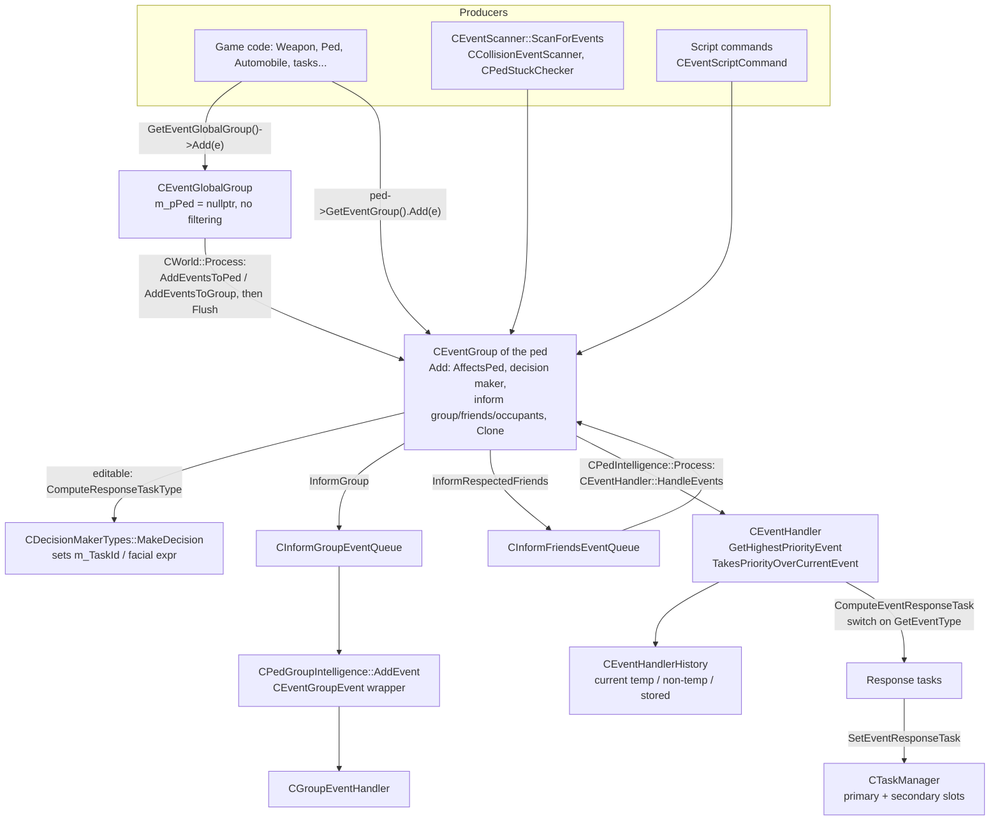

# AI events and decision makers

How peds notice things (gun shots, collisions, threats, script commands...), how those "events" are queued,
prioritised and turned into response tasks, and where decision makers fit in. Written for someone about to reverse
an event class. What happens to the response tasks is in [Tasks.md](Tasks.md). General rules are in
[../ReversingRules.md](../ReversingRules.md) and [../ReversingGuide.md](../ReversingGuide.md).

Paths are relative to `source/game_sa/`. Main folders: `Events/` (about 90 event classes, groups, handler, scanners)
and `DecisionMakers/`. Event ids: `Enums/eEventType.h`. Decision-maker event slots: `Enums/eDecisionMakerEvents.h`.
Addresses come from `RH_*Install`, `StaticRef` or `// 0xADDR` in the repo.

---

## 1. Overview

An **event** (`CEvent` subclass) is a small, cloneable message: "ped X shot at Y", "a car is about to run you
over", "the script wants you to do task T". Events never act by themselves. Every ped has an **event group** (a
16-slot queue) and an **event handler**. Once per frame the handler picks the highest-priority event that still
affects the ped, checks it beats the event the ped is already responding to, and turns it into **response tasks**
that are pushed into the ped's task manager (`TASK_PRIMARY_PHYSICAL_RESPONSE`, `..._EVENT_RESPONSE_TEMP`,
`..._EVENT_RESPONSE_NONTEMP`, plus secondary attack/say/partial-anim/facial tasks).

For **editable-response** events (`CEventEditableResponse`), *which* task is chosen is not hard-coded. It comes
from the ped's **decision maker** (data files in `data\decision\allowed\`), which rolls a task id for the
(event type, relationship to source, in vehicle?) triple when the event is added to the group. The handler then
builds the concrete task object from that id.



---

## 2. Key classes and files

| Class | File | Role |
|---|---|---|
| `CEvent` | `Events/Event.h` | Abstract base. 0xC bytes: `m_nTimeActive` (ticks spent in a queue), `m_bValid` (keep regardless of lifetime). `operator new/delete` go through `GetEventPool()` |
| `CEventEditableResponse` | `Events/EventEditableResponse.h` | Base for events whose response task id is picked by a decision maker. Adds `m_bAddToEventGroup`, `m_TaskId` (`WEnumS16<eTaskType>`), `m_FacialExpressionType`; size 0x14. Pure virtual `CloneEditable()` |
| `CEventGroup` | `Events/EventGroup.h` | Fixed queue of 16 `CEvent*` (`TOTAL_EVENTS_PER_EVENTGROUP`), owned by a ped (`m_pPed`). Size 0x4C, vtable `0x85AAB0` |
| `CEventGlobalGroup` | `Events/EventGlobalGroup.h` | `CEventGroup` with `m_pPed == nullptr`. Singleton through `GetEventGlobalGroup()` (`RwHelper.cpp`, `0x4ABA50`, pointer at `0xA9AF6C`) |
| `CEventHandler` | `Events/EventHandler.h` | Per-ped. Picks the event, computes response tasks (about 60 `Compute*Response` methods, ~3,000 lines). Size 0x34. No vtable |
| `CEventHandlerHistory` | `Events/EventHandlerHistory.h` | What the ped is currently responding to: `m_CurrentTempEvent`, `m_CurrentNonTempEvent`, `m_StoredEventActive` (+ 2 s `m_StoreTimer`). Size 0x1C |
| `CEventScanner` | `Events/EventScanner.h` | Per-ped container of periodic scanners (vehicle/object potential collision, attractor, ped acquaintance, sexy ped, nearby fire). Size 0xD4 |
| `CCollisionEventScanner` | `Collision/CollisionEventScanner.h` | Turns physical collisions into events (`ScanForCollisionEvents`, NOHOOK stub `0x604500`) |
| `CEventSource` | `Events/EventSource.h` | `ComputeEventSourceType(event, ped)`: classifies the event source for the decision maker (NOHOOK stub `0x4ABAC0`) |
| `CEventGroupEvent` | `Events/EventGroupEvent.h` | Wraps another event (`m_event`) plus the originating ped for **ped-group** AI (`AffectsPed` always false) |
| `CGroupEventHandler` | `Events/GroupEventHandler.h` | Group counterpart of `CEventHandler`: returns a `CTaskAllocator*` per event type |
| `CInformGroupEventQueue` / `CInformFriendsEventQueue` | `InformGroupEventQueue.h`, `InformFriendsEventQueue.h` | Delayed propagation of an event to the ped's group / respected friends |
| `CEventPool` | `Pools/EventPool.h` | `CPool<CEvent, CEventDamage>`, 200 slots (`CPools::Initialise`), slot size = `sizeof(CEventDamage)` = 0x44 |
| `CDecisionMakerTypes` | `DecisionMakers/DecisionMakerTypes.h` | Singleton holding 20 decision makers + 5 defaults, `MakeDecision` (ped and group overloads) |
| `CDecisionMaker` | `DecisionMakers/DecisionMaker.h` | 41 `CDecision`s, one per `eDecisionMakerEvents` slot (0x99C bytes) |
| `CDecision` | `DecisionMakers/Decision.h` | Up to 6 task choices with per-relationship probabilities (0x3C bytes) |
| `CDecisionMakerTypesFileLoader` | `DecisionMakers/DecisionMakerTypesFileLoader.h` | Loads `*.ped` / `*.grp` decision files |

`CPedIntelligence` owns, per ped: `m_eventHandler`, `m_eventGroup`, `m_nDecisionMakerType`,
`m_nDecisionMakerTypeInGroup`, `m_nEventId` / `m_nEventPriority` (last event recorded for scripts), `m_eventScanner`,
`m_collisionScanner`. Accessors: `GetEventHandler()`, `GetEventGroup()`, `GetEventScanner()`; `CPed::GetEventGroup()`
forwards to it.

---

## 3. Event flow

### 3.1 Creation

Events are usually built **on the stack** and passed to `Add`, which stores a **clone**:

```cpp
GetEventGlobalGroup()->Add(CEventGunShot{ ... });                              // CWeapon::FireInstantHitFromCar2
veh.m_pDriver->GetEventGroup().Add(CEventDraggedOutCar{ &veh, &ped, true });   // CCarEnterExit::MakeUndraggedDriverPedLeaveCar
m_eventGroup.Add(CEventScriptCommand{TASK_PRIMARY_PRIMARY, task, bAffectsPed}); // CPedIntelligence::AddTaskPrimaryMaybeInGroup
```

The templated `CEventGroup::Add(T event, bool)` overload exists exactly for this. Heap events (`new CEventX`) land in
the 200-slot event pool.

Producers:
- **Direct**: about 70 `GetEventGroup().Add(` call sites across `game_sa` (cheats, ped damage, car AI, ...).
- **Global group**: noise-like events visible to everyone nearby (gun shots, `CEventSoundQuiet`, vehicle on fire,
  `CEventDanger`, `CEventSeenPanickedPed`, `CEventCopCarBeingStolen`, `CEventVehicleHitAndRun`). At the start of
  `CWorld::Process` the game calls `AddEventsToPed` for every ped in the moving list, `AddEventsToGroup` for every ped
  group, processes both inform queues, then `Flush`es the global group.
- **Scanners**: `CPedIntelligence::Process` (`0x608260`) runs the vehicle/ped scanners, then
  `m_eventScanner.ScanForEvents` (still `plugin::CallMethod<0x607E30>`), then `HandleEvents`.
  `CPedIntelligence::ProcessFirst` (`0x6073A0`) runs `CPedStuckChecker::TestPedStuck` and
  `CCollisionEventScanner::ScanForCollisionEvents` into the same group.

### 3.2 Queueing: `CEventGroup::Add` (`0x4AB420`)

For a ped-owned group:
1. If the event `HasEditableResponse()`:
   - ask the decision maker three "would you pick task X?" questions with `ComputeResponseTaskOfType` for
     `TASK_SIMPLE_INFORM_GROUP`, `TASK_SIMPLE_INFORM_RESPECTED_FRIENDS` and `TASK_SIMPLE_LOOK_AT_ENTITY_OR_COORD`;
   - `ComputeResponseTaskType(ped, false)` fills `m_TaskId` / `m_FacialExpressionType` (only if `m_TaskId` is still
     `TASK_NONE`, so an event built with an explicit task keeps it);
   - bail out if `!AffectsPed(ped)`;
   - run `InformGroup`, `InformRespectedFriends` (not for a stealth `CEventDamage`), `TriggerLookAt`,
     `InformVehicleOccupants`;
   - bail out unless `WillRespond()` (`m_TaskId != TASK_NONE`) or it is a `CEventDamage` with `m_bAddToEventGroup`.
2. Otherwise just bail out if `!AffectsPed(ped)`.
3. `CPedIntelligence::RecordEventForScript(type, priority)`.
4. If the queue is full (16), drop the event. Otherwise `Clone()`, set `m_bValid = bValid`, call
   `ReportCriminalEvent(ped)` on the clone, store it.

For the global group (`m_pPed == nullptr`) steps 1-3 are skipped: it only clones. Filtering happens later when each
ped's own group re-adds the event.

Other `CEventGroup` members: `GetHighestPriorityEvent` (`0x4AB7C0`), `TickEvents` (`m_nTimeActive++` on all),
`Remove` (deletes and leaves a **null hole**), `RemoveInvalidEvents` (deletes those failing `IsValid`),
`Reorganise` (`0x4AB700`, compacts holes), `Flush(bKeepBeInGroupScriptCommand)`, `GetEventOfType`,
`HasScriptCommandOfTaskType`.

### 3.3 Scoring

- **Priority**: every class returns a constant from `GetEventPriority()` (a few compute it, see §7). Higher wins.
- `GetHighestPriorityEvent` scans in queue order and takes an event if its priority is `>=` the best so far
  (strictly `>` for `EVENT_SCRIPT_COMMAND`) **and** it `AffectsPed(m_pPed)`. So among equal priorities the **last**
  queued wins, except script commands where the first wins.
- `TakesPriorityOver(other)` defaults to `GetEventPriority() >= other.GetEventPriority()` (`Event.h`). Overridden by
  e.g. `CEventGunShot` (a player shot beats an NPC shot), `CEventScriptCommand` (dead-ped commands beat
  `EVENT_DEATH` / `EVENT_DAMAGE`), `CEventStuckInAir`.
- `CEventHandlerHistory::TakesPriorityOverCurrentEvent` (`0x4BC580`) compares the candidate against the current
  non-temp event, else the current temp event (and the stored event).
- Lifetime: `IsValid` defaults to `m_bValid || m_nTimeActive <= GetLifeTime()`. Nearly every class returns
  `GetLifeTime() == 0`, so an event survives only until the next `HandleEvents` unless added with `bValid = true`.

Sample of priorities (all from the headers' `GetEventPriority`):

| Priority | Event | | Priority | Event |
|---|---|---|---|---|
| 75/63 | `CEventStuckInAir` (computed) | | 50 | `CEventGunAimedAt` |
| 75/71/53 | `CEventScriptCommand` (computed) | | 41 | `CEventGroupEvent` |
| 74 | `CEventRevived` | | 40 | `CEventDraggedOutCar` |
| 73 | `CEventDeath` | | 35 | `CEventGunShot` |
| 72 | `CEventVehicleDied` | | 26 | `CEventAcquaintancePedHate` |
| 70 | `CEventKnockOffBike` | | 21 | `CEventSeenCop` |
| 69 / 68 | `CEventHealthReallyLow` / `CEventHealthLow` | | 20 | `CEventDanger` |
| 66 | `CEventOnFire` | | 16 / 8 | `CEventSoundLoud` / `CEventSoundQuiet` |
| 65 | `CEventDamage` | | 4 / 3 | `CEventSexyPed` / `CEventSexyVehicle` |
| 61 | `CEventInAir` | | 1 / 2 | `CEventPedToChase` / `CEventPedToFlee` |
| 58 / 57 | `CEventVehicleCollision` / `CEventObjectCollision` | | 0 | `CEventAttractor` |

Get the full list with `grep -n "GetEventPriority() const override" source/game_sa/Events/*.h`.

### 3.4 Handling: `CEventHandler::HandleEvents` (`0x4C3F10`)

Called from `CPedIntelligence::Process` (and from `ClearTasks` / `ProcessEventHandler`).
1. `m_History.TickStoredEvent` (re-promotes the stored non-temp event when no temp event is running).
2. Read the active primary task, temp / non-temp event-response tasks; `GetHighestPriorityEvent`; `TickEvents`.
3. Clear history slots whose response task no longer exists.
4. If there is a highest-priority event:
   - `EVENT_DAMAGE` un-statics the ped.
   - Same type as the event already being handled: remove it and stop (no re-response).
   - If `TakesPriorityOverCurrentEvent`: try `MakeAbortable(ABORT_PRIORITY_URGENT)` on the active task. If it refuses,
     `UnTick()` the event (so it survives one more frame), ask for a `LEISURE` abort and retry next frame.
     Otherwise `ComputeEventResponseTask(event, abortedTask)`, record it in the history if a response task was
     produced, `SetEventResponseTask`, and remove the event.
   - Always `RemoveInvalidEvents(false)` + `Reorganise()`.

### 3.5 Response tasks

`ComputeEventResponseTask(CEvent*, CTask*)` (`0x4C3870`) clears the five output slots and `switch`es on
`GetEventType()` into a `Compute<Name>Response(event, tactive, tsimplest)` method. Each method fills some of:

| `CEventHandler` member | Installed by `SetEventResponseTask` (`0x4BC600`) as |
|---|---|
| `m_PhysicalResponseTask` | `AddTaskPhysResponse` |
| `m_EventResponseTask` | `AddTaskEventResponseTemp` if `IsTemporaryEvent(event)` (`0x4BC370`: collisions, potential-walk-into-*, in air, area codes, escalator, fire nearby...), else `AddTaskEventResponseNonTemp` |
| `m_AttackTask` | secondary `TASK_SECONDARY_ATTACK` (old one made abortable) |
| `m_SayTask` | secondary `TASK_SECONDARY_SAY` |
| `m_PartialAnimTask` | secondary `TASK_SECONDARY_PARTIAL_ANIM` |

Editable events also push their `m_FacialExpressionType` to the facial secondary task for 10 s.

Typical response method: read `e->m_TaskId` (the decision maker's pick) and `new` the matching task. For example
`ComputePedThreatResponse` maps `TASK_COMPLEX_KILL_PED_ON_FOOT` to `CTaskComplexKillPedOnFoot` and
`TASK_SMART_FLEE_ENTITY_WALKING` to `CTaskComplexSmartFleeEntity`. The static overload
`ComputeEventResponseTask(const CPed&, const CEvent&)` (`0x4C4220`) runs a temporary handler and returns only the
event-response task (used to ask "what would this ped do?").

### 3.6 Groups and informing

- `InformGroup` (`0x4B7DF0`) clones the event with `m_TaskId = TASK_NONE`, `m_bAddToEventGroup = false` and queues it
  in `CInformGroupEventQueue`. `CInformGroupEvent::Process` later wraps it in a `CEventGroupEvent` and calls
  `CPedGroupIntelligence::AddEvent` (`0x5F7470`), which only accepts `CEventGroupEvent`, uses
  `ComputeResponseTaskType(CPedGroup*)` (group decision maker) and keeps the highest-priority one.
  `CGroupEventHandler::ComputeEventResponseTasks` turns it into a `CTaskAllocator`.
- `InformRespectedFriends` (`0x4B2B00`) re-adds a clone to nearby peds whose respect/like flags match, through
  `CInformFriendsEventQueue`.
- `InformVehicleOccupants` (`0x4AC4A0`) adds a clone to driver and passengers when `DoInformVehicleOccupants(ped)`.

---

## 4. Virtual interface of `CEvent` (= vtable order)

From `Events/Event.h`; `RH_ScopedVirtualClass(CEvent, 0x85AB38, 16)`. Every event class uses vtable size **16** when
deriving directly from `CEvent`, **17** when deriving from `CEventEditableResponse` (adds `CloneEditable`).
`CEventScriptCommand` is also 17 (adds `CloneScriptTask`).

| # | Signature | Default | Notes |
|---|---|---|---|
| 0 | `~CEvent()` | | Deleting dtor in the binary. Release entity refs here |
| 1 | `eEventType GetEventType() const` | pure | Constant. Used by `notsa::isa/dyn_cast` via `To::Type` |
| 2 | `int32 GetEventPriority() const` | pure | Usually a constant |
| 3 | `int32 GetLifeTime()` | pure | Almost always 0 |
| 4 | `CEvent* Clone() const noexcept` | pure | `CEventEditableResponse::Clone` (`0x420ED0`) calls `CloneEditable()` and copies the 3 editable fields |
| 5 | `bool AffectsPed(CPed*)` | `true` | The main filter; most reversing work lives here |
| 6 | `bool AffectsPedGroup(CPedGroup*)` | `true` | |
| 7 | `bool IsCriminalEvent()` | `false` | |
| 8 | `void ReportCriminalEvent(CPed*)` | empty | Called on the stored clone in `CEventGroup::Add` |
| 9 | `bool HasEditableResponse() const` | `false` | `true` in `CEventEditableResponse` (`0x420EF0`); drives `classof<CEventEditableResponse>` |
| 10 | `CEntity* GetSourceEntity() const` | `nullptr` | Used by sound level, look-at, group checks, event source |
| 11 | `bool TakesPriorityOver(const CEvent&)` | priority `>=` | |
| 12 | `float GetLocalSoundLevel()` | `0.0f` | Feeds `GetSoundLevel` (`0x4B2850`) / `CEventGlobalGroup::GetSoundLevel` |
| 13 | `bool DoInformVehicleOccupants(CPed*)` | `false` | |
| 14 | `bool IsValid(CPed*)` | `m_bValid \|\| m_nTimeActive <= GetLifeTime()` | |
| 15 | `bool CanBeInterruptedBySameEvent()` | `false` | Read by `CPedGroupIntelligence` |
| 16 | `CEventEditableResponse* CloneEditable() const noexcept` | pure | Only in `CEventEditableResponse` subclasses |

Non-virtual helpers: `GetSoundLevel`, static `CalcSoundLevelIncrement` (`0x4AC050`), `Tick` / `UnTick`.

`CEventEditableResponse` non-virtuals: `WillRespond` `0x4AC490`, `InformVehicleOccupants` `0x4AC4A0`,
`InformRespectedFriends` `0x4B2B00`, `InformGroup` `0x4B7DF0`, `TriggerLookAt` `0x4AC5A0`,
`ComputeResponseTaskType(CPed*, bool)` `0x4B56C0`, `ComputeResponseTaskType(CPedGroup*)` `0x4B57A0`,
`ComputeResponseTaskOfType` `0x4B5730`.

---

## 5. Decision makers

### 5.1 Data model

- `CDecision` (`Decision.h`): `m_Tasks[6]` (task ids), `m_Probs[6][4]` (one probability per
  `eDecisionRelationship`: neutral, player, friend, threat), `m_Bools[2][6]` (indexed by `eDecisionTypes`).
- `CDecisionMaker`: `std::array<CDecision, DM_TOTAL_NUM_EVENTS>` (41 slots). The slot for an event comes from
  `CDecisionMakerTypes::m_EventIndices[eEventType]` (filled by `LoadEventIndices`, stub `0x600840`). Only events
  listed in `eDecisionMakerEvents` (dragged out car, damage, shot fired, acquaintance hate/dislike/like/respect,
  sexy ped, attractor, gun aimed at, fire nearby, sounds, seen cop, danger, ...) can have data-driven responses.
- `CDecisionMakerTypes`: `m_DecisionMakers[20]` indexed by `eDecisionMakerType` (`DecisionMakerTypes.h`):
  0-7 ped types (`PED_GROUPMEMBER`, `PED_COP`, `PED_RANDOM1..3`, `PED_FIREMAN`, `PED_EMPTY`, `PED_INDOORS`), 8-9
  group types (`GROUP_RANDOM_AGGRESSIVE`, `GROUP_RANDOM_PASSIVE`), 10-19 mission slots. Plus five defaults
  (`m_DefaultRandomPedDecisionMaker`, `...MissionPed...`, `...PlayerPed...`, `...RandomPedGroup...`,
  `...MissionPedGroup...`). Globals: `ScriptReferenceIndex` `0xC0AFF4`, `m_IsActive` `0xC0B01C`.
- The ped's choice is `CPedIntelligence::m_nDecisionMakerType` (and `m_nDecisionMakerTypeInGroup` while in a group,
  `SetPedDecisionMakerType*`, `RestorePedDecisionMakerType`). Scripts change it through
  `CTaskSimpleSetCharDecisionMaker`.

### 5.2 Loading (`DecisionMakerTypesFileLoader.cpp`)

`LoadDefaultDecisionMaker` (`0x5BF400`): unloads all 20, `LoadEventIndices`, loads the five defaults
(`RANDOM.ped`, `m_norm.ped`, `m_plyr.ped`, `RANDOM.grp`, `MISSION.grp`), then the ten built-ins in enum order:
`GangMbr.ped`, `Cop.ped`, `R_Norm.ped`, `R_Tough.ped`, `R_Weak.ped`, `Fireman.ped`, `m_empty.ped`, `Indoors.ped`
(type `DEFAULT_DECISION_MAKER`), `RANDOM.grp`, `RANDOM2.grp` (type `PLAYER_DECISION_MAKER`).

`LoadDecisionMaker(path, CDecisionMaker*)` (`0x6076B0`) reads `data\decision\allowed\<file>`: first line skipped;
each line is `eventType unused` then 6 × (`task`, prob friend/threat/player/neutral, `bools[1]`, `bools[0]`, six
facial-expression probabilities). It writes `m_aDecisions[m_EventIndices[eventType]]` via `SetDefault` + `Set`.
The `(path, eDecisionTypes, bool)` overload (`0x607D30`) loads into a temporary and returns the script handle from
`AddDecisionMaker`.

### 5.3 Making a decision

`CDecisionMakerTypes::MakeDecision` has two overloads, **both still hooked `plugin::Call` stubs**
(`.Reversed = false`):
- ped: `0x606E70` `(ped, eventType, eventSourceType, bInVehicle, avoid1, avoid2, avoid3, seek, bUseInGroupDM,
  int16& taskType, int16& facial)`;
- group: `0x606F80`, returns the `eTaskType`.

How the event code drives it (`CEventEditableResponse::ComputeResponseTaskType` / `ComputeResponseTaskOfType`):
- `ComputeResponseTaskType(ped, inGroup)` avoids the three "side effect" tasks (inform friends, inform group, look
  at) so the chosen task is the *real* response, and writes `m_TaskId` / `m_FacialExpressionType`.
- `ComputeResponseTaskOfType(ped, X)` passes `X` as `seek` and returns whether the roll picked `X`. This is how
  `CEventGroup::Add` decides whether to inform the group / friends or trigger a look-at.
- `eventSourceType` comes from `CEventSource::ComputeEventSourceType` (stub). Presumably it selects the
  relationship column of `m_Probs`; this is not verified in the repo.

---

## 6. Conventions for reversing an event class

Templates taken from `CEventOnFire` (simple), `CEventGunShot` and `CEventDanger` (editable, with an entity
reference), `CEventSeenCop` (inherits a constructor).

### Header

```cpp
#pragma once
#include "EventEditableResponse.h"       // or "Event.h" for a plain event

class NOTSA_EXPORT_VTABLE CEventDanger : public CEventEditableResponse {   // macro is mandatory (vtable lookup)
public:
    CEntity* m_dangerFrom;
    float    m_dangerRadius;

public:
    CEventDanger(CEntity* dangerFrom, float dangerRadius);
    ~CEventDanger() override;

    eEventType GetEventType() const override { return EVENT_DANGER; }
    int32 GetEventPriority() const override { return 20; }
    int32 GetLifeTime() override { return 0; }
    bool AffectsPed(CPed* ped) override;
    bool AffectsPedGroup(CPedGroup* pedGroup) override;
    CEntity* GetSourceEntity() const override;
    CEventDanger* CloneEditable() const noexcept override { return new CEventDanger(m_dangerFrom, m_dangerRadius); }

private:
    friend void InjectHooksMain();
    static void InjectHooks();
    CEventDanger* Constructor(CEntity* dangerFrom, float dangerRadius);
};
VALIDATE_SIZE(CEventDanger, 0x1C);
```

Rules seen across the reversed classes:
- Declare overrides **in the base vtable order** (§4) to make review against IDA easy.
- Trivial getters (`GetEventType`, `GetEventPriority`, `GetLifeTime`, `Clone` / `CloneEditable`,
  `GetLocalSoundLevel`, ...) stay inline in the header; their binary copies are tiny and usually not hooked.
- Plain events override `Clone()`; editable events override **only** `CloneEditable()` and let
  `CEventEditableResponse::Clone` copy `m_TaskId` / facial / `m_bAddToEventGroup`.
- If you want `notsa::isa/dyn_cast<CEventX>`, add `static constexpr auto Type = EVENT_X;` and return it from
  `GetEventType` (`CEventScriptCommand`, `CEventGunAimedAt`, `CEventDamage`, `CEventGroupEvent`,
  `CEventGunShotWhizzedBy` do).
- Entity pointers: `CEntity::SafeRegisterRef` in the ctor, `SafeCleanUpRef` in the dtor (see the `CEventGunShot` and
  `CEventDanger` constructors and destructors).
- Subclasses that only change type/priority reuse the base ctor: `using CEventAcquaintancePed::CEventAcquaintancePed;`
  (`EventSeenCop.h`).
- Always end with `VALIDATE_SIZE`. Sizes must fit the event pool slot (0x44, `CEventDamage`).

### Source

```cpp
void CEventGunShot::InjectHooks() {
    RH_ScopedVirtualClass(CEventGunShot, 0x85ABE0, 17);   // GTA vtable address, number of virtuals
    RH_ScopedCategory("Events");

    RH_ScopedInstall(Constructor, 0x4AC610);
    RH_ScopedVMTInstall(AffectsPed, 0x4B2CD0);
    RH_ScopedVMTInstall(IsCriminalEvent, 0x4AC810);
    RH_ScopedVMTInstall(TakesPriorityOver, 0x4AC780);
    RH_ScopedVMTInstall(CloneEditable, 0x4B6B20);
}
```

- Overloaded ctors get numbered wrappers (`Constructor1` in `EventSeenCop.cpp`).
- Older files hook virtuals with plain `RH_ScopedInstall` (`CEventScriptCommand::InjectHooks`); prefer VMT installs
  in new code.
- Keep the category `"Events"` (or `"DecisionMakers"`).
- Add `CEventX::InjectHooks();` to the `Events` lambda in `source/InjectHooksMain.cpp`. Lines written
  `// + CEventX::InjectHooks();` there mark classes that exist in C++ but register no hooks yet.
- If the class has a dedicated response method, also check `CEventHandler::Compute<X>Response` and
  `CGroupEventHandler::ComputeResponse<X>`. The event is only half the behaviour.

---

## 7. Gotchas

- **Every `Add` clones.** Both `CEventGroup::Add` and `CEventGlobalGroup::AddEventsToPed/ToGroup` clone; the latter
  even clones *before* `Add` and deletes its copy. A wrong `Clone` / `CloneEditable` (missing field) silently breaks
  every event that goes through a queue.
- **Editable fields are copied by the base `Clone`, not by `CloneEditable`.** Don't duplicate that in subclasses.
- **`Remove` leaves holes.** `m_count` is not decremented, and `GetEvents()` iterates the null slot.
  `GetHighestPriorityEvent` dereferences without a null check, so always `Reorganise()` after `Remove`, as
  `HandleEvents` does.
- **Same-priority ties.** `>=` in both `GetHighestPriorityEvent` and the default `TakesPriorityOver` means the newer
  event wins, except script commands (strict `>`).
- **Lifetime 0 + `UnTick()`**: an event that cannot be responded to this frame survives only because
  `HandleEvents` calls `UnTick()`. `CEventScriptCommand::IsValid(ped)` ignores the lifetime and returns
  `ped->IsAlive()`, so script commands stay queued while the ped lives.
- **Computed priorities.** `CEventScriptCommand::GetEventPriority` (`0x4B0B20`: 75 for dead-ped commands, 71 for
  die/swim/phone/looped anim, else 53) and `CEventStuckInAir::GetEventPriority` (75 or 63, depends on the handler's
  current event and queue length).
- **Type shared by two classes.** `CEventPlayerCommandToGroupAttack::GetEventType()` returns
  `EVENT_PLAYER_COMMAND_TO_GROUP`, the same as its base, so a type check cannot tell them apart.
- **`eEventType` has gaps** (no 0, 22-24, 29, 34, 40, 68, 78, 80, 82-87, 91, 95; `EVENT_TOTAL_NUM_EVENTS = 96`).
  Don't size arrays by counting enumerators.
- **Missing `NOTSA_EXPORT_VTABLE`** on `CEventHealthLow`, `CEventHealthReallyLow`, `CEventHighAngerAtPlayer`,
  `CEventPotentialWalkIntoBuilding`, `CEventSignalAtPed`, `CEventSoundLoud`. `RH_ScopedVirtualClass` finds our vtable
  through the exported symbol (`FindVMTAddressByClassName` in `source/reversiblehooks/VMTInfo.cpp`), so add the macro
  before hooking them.
- **Unhooked but implemented.** Many event classes are complete in C++ (no `plugin::` calls) but have no
  `InjectHooks`, so the game's own code still runs the original version and ours runs only when *our* code
  constructs the event. Behaviour can differ without anything flagging it.
- **Global group has no ped.** `CEventGlobalGroup` is built with `nullptr`; `Add` on it skips `AffectsPed`, decision
  makers and `RecordEventForScript`. Don't add ped-specific logic that assumes `m_pPed`.
- **Group AI only accepts `CEventGroupEvent`** (`CPedGroupIntelligence::AddEvent`). Plain events pushed by
  `AddEventsToGroup` are ignored unless they are group events.
- **Decision makers are mostly stubs.** Every `CDecisionMakerTypes` method is a hooked `.Reversed = false`
  `plugin::Call` stub. `CDecision::Set` / `SetDefault` are stubs too (`Add`, `HasResponse` and `MakeDecision` are
  not even hooked). `CDecisionMakerTypesFileLoader::UnloadDecisionMaker` is locked to GTA ("Causes esp check
  failure"). `DecisionSimple.cpp` is empty.
- **`eDecisionTypes` names are misleading.** `DEFAULT_DECISION_MAKER` / `PLAYER_DECISION_MAKER` are used as "ped file"
  vs "group file" when loading, and `ReStart` / `LoadDefaultDecisionMaker` cast plain indices to it.
- **Scanners are stubs.** `CEventScanner::ScanForEvents` (`0x607E30`),
  `CVehiclePotentialCollisionScanner::ScanForVehiclePotentialCollisionEvents` (`0x603720`),
  `CCollisionEventScanner::ScanForCollisionEvents` (`0x604500`) and `CEventSource::ComputeEventSourceType`
  (`0x4ABAC0`) are `plugin::Call` stubs with no hook (`InjectHooksMain.cpp` lists `CEventSource` and `CEventScanner`
  as `// - ...` comments). The standalone headers `NearbyFireScanner.h`, `ObjectPotentialCollisionScanner.h`,
  `PedAcquaintanceScanner.h`, `SexyPedScanner.h`, `VehiclePotentialCollisionScanner.h` redefine classes already in
  `EventScanner.h` and are not included anywhere; including one next to `EventScanner.h` is a redefinition error.
- **Unfinished handler parts.** `CEventHandler::RecordActiveEvent` / `RecordPassiveEvent` are `assert(false)`;
  `ComputeKnockOffBikeResponse` (`0x4B9FF0`), `ComputePedCollisionWithPedResponse` (`0x4BDB80`) and
  `ComputePedCollisionWithPlayerResponse` (`0x4BE7D0`) are `.Reversed = false` stubs; `ComputeVehicleHitAndRunResponse`
  has no address; `ComputePlayerWantedLevelResponse` is `NOTSA_UNREACHABLE` ("This event doesn't seem to exist").
  `ResetResponse` nulls the five task pointers without deleting them (commented as a possible bug).
- **`CPedIntelligence::GetActivePrimaryTask` always reads the PHYSICAL_RESPONSE slot**, and `HandleEvents` depends on
  it (see [Tasks.md](Tasks.md) §7).
- **The coverage tool undercounts events.** It matches by address, so inline header functions (`GetEventType`,
  `Clone`, dtors) count as MISSING even when the C++ is complete.

---

## 8. What is left

Snapshot from `idb_coverage.py --classes 400 --filter Event`, summed over the 92 matching classes (85 are `CEvent*`,
the rest are `CEventHandler`-related, scanners, `CInterestingEvents`, `CInformGroupEvent`, ...):

| Status | Functions |
|---|---|
| total | 871 (about 38 KB of code left) |
| reversed | 295 |
| stub (`.Reversed = false`) | 9 |
| NOHOOK (`plugin::Call` without hook) | 4 |
| KNOWN (address in repo, not hooked) | 32 |
| MISSING (no address in repo) | 531 |

The infrastructure is nearly done: `CEventHandler` 69/72, `CGroupEventHandler` 30/32, `CEventHandlerHistory` 10/11,
`CEventGroup` 12/14, `CEventEditableResponse` 11/13. The biggest remaining chunks are `CEventHandler` (3 stubs, 7,891
bytes), `CCollisionEventScanner` (one 3,555-byte function), `CInterestingEvents` (2,541), `CGroupEventHandler`
(2,412) and `CEventScanner` (1,395). Most of the MISSING count is per-event boilerplate (ctor, dtor, getters,
`Clone`) without addresses.

`--untouched 60 --filter Event` lists **19 classes with no address in the repo**. They all have C++ in the repo
already (header and, for most, a `.cpp` without `plugin::` calls); what's missing is addresses, verification against
IDA and an `InjectHooks`:

| Class | Funcs | Bytes | | Class | Funcs | Bytes |
|---|---|---|---|---|---|---|
| `CEventSexyPed` | 9 | 647 | | `CEventFireNearby` | 9 | 285 |
| `CEventPedEnteredMyVehicle` | 10 | 493 | | `CEventRevived` | 8 | 180 |
| `CEventPotentialGetRunOver` | 10 | 464 | | `CEventSpecial` | 7 | 179 |
| `CEventChatPartner` | 8 | 403 | | `CEventHealthLow` | 8 | 171 |
| `CEventSexyVehicle` | 8 | 390 | | `CEventHealthReallyLow` | 8 | 171 |
| `CEventVehicleThreat` | 8 | 388 | | `CEventHighAngerAtPlayer` | 8 | 171 |
| `CEventCreatePartnerTask` | 8 | 358 | | `CEventLowAngerAtPlayer` | 7 | 153 |
| `CEventInWater` | 9 | 341 | | `CEventAcquaintancePedRespect` / `Like` / `Dislike` | 5 each | 141 each |
| `CEventInteriorUseInfo` | 9 | 285 | | | | |

**Good first targets** (smallest, already written, only need addresses + hooks + checking):
1. `CEventAcquaintancePedLike` / `Dislike` / `Respect`: type, priority and `CloneEditable` only, like the already
   hooked `CEventSeenCop`.
2. `CEventRevived` (`AffectsPed` in `EventRevived.cpp`), `CEventSpecial`, `CEventLowAngerAtPlayer`.
3. `CEventHealthLow`, `CEventHealthReallyLow`, `CEventHighAngerAtPlayer`: add `NOTSA_EXPORT_VTABLE` first.
4. Then `CEventFireNearby`, `CEventInWater`, `CEventInteriorUseInfo`, `CEventVehicleThreat`, `CEventSexyVehicle`.

Use `idb_coverage.py --class CEventRevived` (for example) to get the IDA function list, and turn
`// + CEventX::InjectHooks();` into `CEventX::InjectHooks();` in `InjectHooksMain.cpp`. Bigger behavioural targets
after that: the three `CEventHandler` stubs, `CEventScanner::ScanForEvents`, `CCollisionEventScanner`,
`CEventSource::ComputeEventSourceType`, and `CDecisionMakerTypes::MakeDecision` (both overloads).
