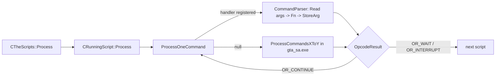

# SCM script engine (mission scripts)

How `main.scm` runs: loading the script file, the list of running scripts, the per-frame loop, how an opcode reaches
its handler (ours or the original one), how arguments are read and results stored, and what is left to reverse. Read
this before you reverse a script command or a `CRunningScript` / `CTheScripts` method. The argument-type cheat sheet
is [../ScriptCommandReversing.md](../ScriptCommandReversing.md); the step-by-step skill is
`.claude/skills/reverse-script-command/SKILL.md`.

All paths are relative to the repo root. Addresses are the ones written in the repo (`RH_*Install`, `StaticRef` or
`// 0xADDR`) and were checked against the IDB.

---

## 1. Overview

```
main.scm (data\script\main.scm, or MPACK\MPACKn\SCR.SCM)
   │  CTheScripts::Init reads the first 200,000 bytes into ScriptSpace
   v
CTheScripts::ScriptSpace  (0xA49960, 269,000 bytes)
   ├─ MainSCMBlock [0 .. 200,000)        header chunks + global variables + main script code
   └─ MissionBlock [200,000 .. 269,000)  one mission at a time, loaded by LOAD_AND_LAUNCH_MISSION_INTERNAL

ScriptsArray[96] (CRunningScript, 0xA8B430)  ── two intrusive doubly-linked lists
   ├─ pActiveScripts (0xA8B42C)  run every frame by CTheScripts::Process
   └─ pIdleScripts   (0xA8B428)  free slots

CTheScripts::Process (each frame)
   └─ for each active script: timers += dt; CRunningScript::Process
         └─ if now >= m_WakeTime: while (ProcessOneCommand() == OR_CONTINUE) {}
               └─ s_CustomCommandHandlerTable[op] ?  our handler (CommandParser<Cmd, Fn>)
                                                  :  s_OriginalCommandHandlerTable[op / 100](this, op)
```



---

## 2. Where things live

| File | Role |
|---|---|
| `source/game_sa/Scripts/RunningScript.h/.cpp` | `CRunningScript` (one script "thread", size `0xE0`), parameter reading/storing, `Process`, `ProcessOneCommand`, the custom handler table, `scm::` helper types (`StringRef`, `ArrayAccess`, `Instruction`) |
| `source/game_sa/Scripts/TheScripts.h/.cpp` | `CTheScripts`: script space, script lists, `Init`/`Process`/`Load`/`Save`, script "things" (spheres, checkpoints, search lights, effects), mission entity cleanup helpers, debug drawing |
| `source/game_sa/Scripts/SCMChunks.hpp` | Layout of the `main.scm` header chunks (`tSCMChunkHeader` and the per-chunk structs) |
| `source/game_sa/Scripts/ScriptParam.h` | `tScriptParam`: the 4-byte union used for every variable and for `ScriptParams` |
| `source/game_sa/Scripts/OpcodeResult.h` | `OR_CONTINUE` (0), `OR_WAIT` (1), `OR_INTERRUPT` (-1), `OR_IMPLEMENTED_YET` (-2, NOTSA) |
| `source/game_sa/Scripts/CommandParser/` | `Parser.hpp` (dispatch template + `REGISTER_COMMAND_*` macros), `ReadArg.hpp` (`notsa::script::Read<T>`), `StoreArg.hpp` (`StoreArg`), `Utility.hpp` (`MultiRet`, `return_multiple`, `CompareFlagUpdate`, `CommandHandlerFunction`). `LUTGenerator.hpp` is dead code (`#if 0`) |
| `source/game_sa/Scripts/Commands/*.cpp` | Our handlers, one file per category (`CharacterCommands.cpp` is the biggest: 4,482 lines, 272 handlers). Each file ends with `notsa::script::commands::<ns>::RegisterHandlers()` |
| `source/game_sa/Scripts/Commands/CLEO/` | CLEO opcodes (only compiled in with `NOTSA_WITH_CLEO_SCRIPT_COMMANDS`, see Gotchas) |
| `source/game_sa/Enums/eScriptCommands.h` | `eScriptCommands` (`COMMAND_X = 0xNNNN`). PC vanilla ends at `COMMAND_DO_DEBUG_STUFF = 0x0A4E` (`COMMAND_HIGHEST_VANILLA_ID`) |
| `source/game_sa/ScriptsForBrains.h/.cpp` | `CScriptsForBrains`: 70 `tScriptForBrains` entries that tie streamed scripts to ped models / objects / attractors |
| `source/game_sa/StreamedScripts.*`, `MissionCleanup.*`, `UpsideDownCarCheck.*`, `StuckCarCheck.*`, `ScriptResourceManager.*` | Helpers owned by `CTheScripts` (`StreamedScripts` 0xA47B60, `MissionCleanUp` 0xA90850, `UpsideDownCars` 0xA4892C, `StuckCars` 0xA90AB0, `ScriptResourceManager` 0xA485A8) |
| `source/reversiblehooks/ReversibleHook/ScriptCommandHook.h` | Per-command hook object for the hooks UI (only with `NOTSA_WITH_SCRIPT_COMMAND_HOOKS`) |
| `docs/ScriptCommandReversing.md` | `Read<T>` / `StoreArg` type table |

---

## 3. Run-time lifecycle

### 3.1 Loading `main.scm` (`CTheScripts::Init`, `0x468D50`)

Called from `CGame::Init2`, `CGame::ReInitGameObjectVariables` and at the top of `CTheScripts::Load`.

1. Zero `ScriptSpace` and `LocalVariablesForCurrentMission`; `Init()` all 96 scripts and chain them into
   `pIdleScripts` (`pActiveScripts = nullptr`).
2. `MissionCleanUp.Init()`, `UpsideDownCars.Init()`, `StuckCars.Init()`, `ScriptsForBrains.Init()`,
   `ScriptResourceManager.Initialise()`, clear `EntitiesWaitingForScriptBrain`.
3. Read up to `MAIN_SCRIPT_SIZE` (200,000) bytes of `data\script\main.scm` (or `MPACK//MPACKn//SCR.SCM` for a mission
   pack) into `ScriptSpace`.
4. Parse the header chunks: `ReadObjectNamesFromScript` + `UpdateObjectIndices` (chunk 0),
   `ReadMultiScriptFileOffsetsFromScript` (chunk 1), `StreamedScripts.ReadStreamedScriptData()` (chunk 2, skipped for
   mission packs).
5. Reset a long list of script-controlled globals (HUD, radar, crane, text, rectangles, sprites, swaps, search lights,
   checkpoints, sequences) and call `CScripted2dEffects::Init`, `CTaskSequences::Init`, `CPedGroups::Init`,
   inform-event queues and `CDecisionMakerTypes::GetInstance`.

The main script is **not** started by `Init`. `CTheScripts::StartTestScript` (`0x464D40`) does
`StartNewScript(MainSCMBlock.data())`; it is called by `CGame::Initialise` and by
`ReInitGameObjectVariables` when not loading a save, each time followed by one `CTheScripts::Process`.

### 3.2 `main.scm` header chunks (`SCMChunks.hpp`)

Every chunk starts with an 8-byte `tSCMChunkHeader`: a `GOTO` instruction (`02 00 01`) whose `int32` operand is the
offset of the next chunk, then a 1-byte chunk index. The VM simply jumps over them; the last one jumps to the main code.

| Index | Struct | Content |
|---|---|---|
| `'s'` | `tSCMGlobalVarChunk` | Global variable space. Its `m_NextChunkOffset` is the size saved by `CTheScripts::Save` |
| `0` | `tSCMUsedObjectsChunk` | Names of the "used objects" (`UsedObjectArray`, 395 entries, model ids for negative model args) |
| `1` | `tSCMScriptFileInfoChunk` | Main size, largest mission size, mission count, exclusive count, largest mission local-var count, then `uint32` offsets → `MultiScriptArray` |
| `2` | `tSCMStreamedScriptFileInfoChunk` | Streamed scripts (`script.img`): name, offset, size (28 bytes each) |
| `3` | `tSCMUnknownChunk3` | one `uint32`, unknown |
| `4` | `tSCMExtraInfoChunk` | global var space size, build number(?) |

`CTheScripts::GetSCMChunk<T>()` (NOTSA) walks at most 6 chunks to find one.

### 3.3 Variables and the script layout

- **Globals** live inside `ScriptSpace` itself. A global variable operand is a **byte offset** into `ScriptSpace`
  (`GetGlobal<T>(loc)` = `ScriptSpace[loc]`). The `OnAMissionFlag` global (`0xA476AC`) stores the *offset* of the
  `$ONMISSION` variable, read as `ScriptSpace[OnAMissionFlag]`.
- **Locals** are `tScriptParam` slots (`MAX_LOCAL_VARS = 32` plus `MAX_NUM_TIMERS = 2`). A local operand is a
  **slot index**. `GetLocal<T>` reads
  `CTheScripts::LocalVariablesForCurrentMission[loc]` (1,024 slots at `0xA48960`) when
  `m_ThisMustBeTheOnlyMissionRunning` is set, otherwise `m_LocalVars[loc]`.
- **Timers** are local slots 32 and 33 (`SCRIPT_VAR_TIMERA`/`TIMERB`): `TIMERA`/`TIMERB` in
  Sanny Builder (`32@`, `33@`). `CTheScripts::Process` adds the frame time to both, in every script and in the mission
  local block.
- **Arrays** use a 6-byte `scm::ArrayAccess` operand: base, index variable (global or local),
  size, element type. Global array elements are `base + idx * elemBytes`; local ones are `base + idx * elemSlots`.

`CRunningScript` fields (`VALIDATE_SIZE 0xE0`):

| Off | Field | Notes |
|---|---|---|
| 0x00 | `m_pNext`, `m_pPrev` | list links (active or idle list) |
| 0x08 | `m_szName[8]` | set by `SCRIPT_NAME`, `"noname"` by `Init` |
| 0x10 | `m_BaseIP` | base for negative (relative) jump targets: mission block or streamed script |
| 0x14 | `m_IP` | current instruction pointer |
| 0x18 | `m_IPStack[8]`, `m_StackDepth` (0x38) | `GOSUB` return addresses |
| 0x3C | `m_LocalVars[34]` | 32 locals + 2 timers |
| 0xC4 | `m_IsActive`, `m_CondResult`, `m_UsesMissionCleanup`, `m_IsExternal`, `m_IsTextBlockOverride`, `m_ExternalType` | `m_ExternalType` is the brain type (-1 = normal script) |
| 0xCC | `m_WakeTime` | `WAIT` sets it to now + ms |
| 0xD0 | `m_AndOrState`, `m_NotFlag`, `m_IsDeathArrestCheckEnabled`, `m_DoneDeathArrest` | |
| 0xD8 | `m_SceneSkipIP` | cutscene skip target |
| 0xDC | `m_ThisMustBeTheOnlyMissionRunning` | "is the mission script": locals come from the mission block |

Jump targets: `UpdatePC(int32)` (`0x464DA0`): `>= 0` is an absolute offset into
`ScriptSpace` (main script), `< 0` is `m_BaseIP + |target|` (missions and streamed scripts are position independent).

### 3.4 Starting and stopping scripts

- `CTheScripts::StartNewScript(ip)` (`0x464C20`) takes the head of `pIdleScripts`, `Init()`s it, sets the IP and moves
  it to `pActiveScripts`. No null check (same as the original). The `(ip, index)` overload (`0x464C90`) picks a
  specific slot; `Load` uses it.
- `START_NEW_SCRIPT` (`BasicCommands.cpp`) then copies the trailing arguments into the new script's locals with
  `ReadParametersForNewlyStartedScript` (`0x464500`, reads until `SCRIPT_PARAM_END_OF_ARGUMENTS`).
- Missions: `LOAD_AND_LAUNCH_MISSION_INTERNAL` (`MissionCommands.cpp`) reads `MISSION_SCRIPT_SIZE` (69,000) bytes
  from `main.scm` at `MultiScriptArray[id]` into `MissionBlock`, wipes the mission locals, starts a script there with
  `m_UsesMissionCleanup = m_ThisMustBeTheOnlyMissionRunning = true`, `m_BaseIP = MissionBlock`, and sets
  `bAlreadyRunningAMissionScript`.
- `TERMINATE_THIS_SCRIPT` moves the script back to the idle list, calls
  `ShutdownThisScript` (`0x465AA0`, still a stub: releases a streamed script and clears the ped's script brain) and
  returns `OR_WAIT`.

### 3.5 Per frame: `CTheScripts::Process` (`0x46A000`)

Called from `CGame::Process`, after loading a save (`CGenericGameStorage::DoGameSpecificStuffAfterSucessLoad`) and on entry/exit teleports
(`CEntryExit`). Skipped during replay playback.

1. `CommandsExecuted = 0`; `UpsideDownCars.UpdateTimers()`, `StuckCars.Process()`,
   `MissionCleanUp.CheckIfCollisionHasLoadedForMissionObjects()`, `DrawScriptSpheres()`, `ProcessAllSearchLights()`,
   `ProcessWaitingForScriptBrainArray()`.
2. `FailCurrentMission` counts down. Intro texts/rectangles are cleared when `UseTextCommands` is on.
3. Timers += `CTimer::GetTimeStepInMS()`, then `it->Process()` for every active script (next pointer saved first:
   a script may terminate itself).
4. `RecordEventForScript(0, 0)` on every mission-created ped.

### 3.6 `CRunningScript::Process` (`0x469F00`)

1. Cutscene skip: if `m_SceneSkipIP` and the skip button is pressed, jump there and clear `m_WakeTime`.
2. `m_UsesMissionCleanup` → `DoDeathArrestCheck` (`0x485A50`): on a mission, if the player is restarting after death
   or arrest, unwind the `GOSUB` stack to its first entry, clear small messages and `$ONMISSION`, set
   `m_DoneDeathArrest`.
3. Mission script with `FailCurrentMission == 1`: unwind the stack the same way.
4. `CTheScripts::ReinitialiseSwitchStatementData()`.
5. If `now >= m_WakeTime`: `while (ProcessOneCommand() == OR_CONTINUE) {}`.

`ProcessOneCommand` (`0x469EB0`, inlined in the original `Process`) increments
`CommandsExecuted`, reads the 2-byte `scm::Instruction` (15-bit command + not-flag bit 15, i.e. `0x8000`), stores the
not-flag in `m_NotFlag` and dispatches (section 4). Return values: `OR_CONTINUE` = run the next command now,
`OR_WAIT` = yield until next frame (or `m_WakeTime`), `OR_INTERRUPT` = also stops this script for the frame (the
original's "unknown command" path).

### 3.7 Mission cleanup

`CMissionCleanup` (`MissionCleanup.h`, 75 `tMissionCleanupEntity {type, handle}` slots) records everything a mission
creates: peds, vehicles, objects, particles, groups, sequences, decision makers, search lights, checkpoints, TXDs. A
command that creates an entity calls `MissionCleanUp.AddEntityToList(...)` when `m_UsesMissionCleanup` is set; in
`CharacterCommands.cpp` use the helper `HandleEntityMissionCleanup(S, entity)`. `MARK_*_AS_NO_LONGER_NEEDED`
removes it again. `CMissionCleanup::Process` (`0x468560`, called on mission end) is still a call into GTA.

### 3.8 Save and load (`CTheScripts::Save` `0x5D4C40`, `Load` `0x5D4FD0`)

Order in the save block: size + global variable space (in 51,200-byte parts), the 70
`tScriptForBrains`, `OnAMissionFlag`, `LastMissionPassedTime`, building swaps and invisibility settings (as pool index
+ 1, typed by `ScriptSavedObjectType`), blocked vehicle models, connected LODs, attached anim groups, a few flags and
sizes, then every **non-external** active script (`!m_IsExternal && m_ExternalType == -1`): slot index, the raw
`CRunningScript`, IP and the 8 stack entries as offsets into `ScriptSpace`. Scripts are written from the tail of the
active list so that `Load` recreates the same order. Streamed scripts and brains are not saved: they restart from
`ScriptsForBrains`. `Load` starts with `Init()`.

### 3.9 Streamed scripts and script brains

- `CStreamedScripts` (fully reversed, `StreamedScripts.cpp`) manages the scripts in `script.img`. They are streamed
  like models (`SCMToModelId(index)`); a started one runs with `m_IsExternal = true`, `m_BaseIP` at its buffer.
- `CScriptsForBrains` (`ScriptsForBrains.h`) maps a brain (`m_StreamedScriptIndex`, `m_TypeOfBrain`, activation
  radius, model / generator id or attractor name) to a streamed script. Types used in code: 0 and 3 = ped brains, 1
  and 4 = object brains, 5 = attractor brains (`GetIndexOfScriptBrainWithThisName(name, 5)`).
- Entities that need a brain call `CheckIfNewEntityNeedsScript` (from `CCarGenerator` and `CDummyObject`) and
  wait in `EntitiesWaitingForScriptBrain` (150 entries). `CTheScripts::ProcessWaitingForScriptBrainArray` (`0x46CF00`)
  starts the script once its streamed file is loaded (`StartNewStreamedScriptBrain`) or
  requests it.
- Brain scripts run as normal scripts with `m_ExternalType` = brain type; local 0 holds the entity handle. That is why
  `CRunningScript::GivePedScriptedTask` checks `m_ExternalType` 0/2/3/5 and routes type 5 tasks into
  `CScriptedBrainTaskStore` (see [Tasks.md](Tasks.md)).

---

## 4. Command dispatch

### 4.1 Two tables

```cpp
// RunningScript.cpp
static inline std::array<notsa::script::CommandHandlerFunction, COMMAND_HIGHEST_ID_TO_HOOK + 1> s_CustomCommandHandlerTable{};
// RunningScript.h
static inline auto& s_OriginalCommandHandlerTable = StaticRef<std::array<CommandHandlerFn_t, 27>>(0x8A6168);
```

`ProcessOneCommand` calls our handler if the slot is non-null, otherwise
`s_OriginalCommandHandlerTable[op / 100](this, op)`. The original table (`_opcodeHandlerTable` in the IDB) holds the 27
member functions `CRunningScript::ProcessCommands0To99` (`0x465E60`) ... `ProcessCommands2600To2699` (`0x479DA0`):
each is one giant `switch` over 100 opcodes (**decimal** blocks: opcode `0x02AB` = 683 → `600To699`). Unknown cases
return `OR_INTERRUPT`.

The custom table is filled at start-up by `CRunningScript::InjectCustomCommandHooks()`, which calls each `notsa::script::commands::<ns>::RegisterHandlers()`.

### 4.2 Registration macros (`CommandParser/Parser.hpp`)

| Macro | Effect |
|---|---|
| `REGISTER_COMMAND_HANDLER_BEGIN("Category")` | Once per `RegisterHandlers`; sets the hooks-UI category `Scripts/Commands/<Category>` |
| `REGISTER_COMMAND_HANDLER(COMMAND_X, Fn)` | Stores `&CommandParser<COMMAND_X, Fn>` in the table (unreachable-asserts if already set) and creates a `ScriptCommandHook` |
| `REGISTER_COMMAND_NOP(COMMAND_X, T...)` | Handler that reads arguments of types `T...` and does nothing. The types decide how far the IP moves |
| `REGISTER_COMMAND_UNIMPLEMENTED(COMMAND_X)` | `NotImplemented`: logs, `NOTSA_DEBUGBREAK()`, returns `OR_INTERRUPT` (the vanilla default path). For opcodes the original never implemented |
| `REGISTER_UNSUPPORTED_COMMAND_HANDLER(COMMAND_X, Fn)` | `Fn` only with `IMPLEMENT_UNSUPPORTED_OPCODES`, otherwise `NotImplemented` |

With the CMake option `GTASA_WITH_SCRIPT_COMMAND_HOOKS` (defines `NOTSA_WITH_SCRIPT_COMMAND_HOOKS`) every registered
command shows up in the hooks UI; turning one off nulls its table slot so the original switch runs it
(`ScriptCommandHook.h`). Handlers are installed either way.

### 4.3 Command statuses

`script_cmd.py` sorts each vanilla opcode by repo status and by what the original case does:

| Repo status | Meaning |
|---|---|
| HANDLER | `REGISTER_COMMAND_HANDLER`: our C++ runs |
| NOP | `REGISTER_COMMAND_NOP`: argument-consuming no-op |
| UNIMPLEMENTED | `REGISTER_COMMAND_UNIMPLEMENTED`: debug-break + `OR_INTERRUPT` |
| UNREGISTERED | No registration: the original `ProcessCommandsXToY` runs it. This is the work left |

Snapshot from `python .claude/skills/reverse-script-command/scripts/script_cmd.py stats` (2,639 vanilla commands,
opcodes `<= 0x0A4E`):

| Repo status \ original | real | real/shared | default? | no-op | not-impl | no case |
|---|---|---|---|---|---|---|
| HANDLER | 587 | 22 | 21 | 15 | 8 | 2 |
| NOP | 27 | 10 | 0 | 245 | 0 | 0 |
| UNIMPLEMENTED | 3 | 2 | 62 | 50 | 486 | 110 |
| UNREGISTERED | **925** | 43 | 2 | 6 | 13 | 0 |

`real` = unique case code; `real/shared` = case shared by 2-7 opcodes (VAR/LVAR variants); `default?` = shared by 8+;
`no-op` = returns `OR_CONTINUE` without reading anything; `not-impl` = returns `OR_INTERRUPT`. The 655 HANDLER rows
include the 14 handlers of `DrawCommands.cpp` and `PathCommands.cpp` that are never registered at run time (Gotchas).

### 4.4 How our handler gets its arguments (`Parser.hpp`)

`CommandParser<Cmd, Fn>` resets `ScriptArgCharNextFreeBuffer`, then `CollectArgsAndCall` reads one argument per
parameter of `Fn`, **in declaration order**, with `notsa::script::Read<T>(S)` (`ReadArg.hpp`). A parameter of
type `eScriptCommands` receives the current opcode without reading anything; `CRunningScript&`/`*` receives the
script. The return value is then written back with `StoreArg`:

| `Fn` returns | Effect (`StoreArg.hpp`) |
|---|---|
| `void` | nothing, `OR_CONTINUE` |
| `OpcodeResult` | returned as is (use for `WAIT`-like commands) |
| `bool` / `CompareFlagUpdate` | **not stored**: `UpdateCompareFlag(value)` |
| arithmetic / enum | one variable (zeroed, then `memcpy`) |
| `CPed*`, `CVehicle*`, ... | the pool handle, `-1` for `nullptr` |
| `CVector` / `CVector2D` | 3 / 2 floats |
| `MultiRet<A, B, ...>` (`notsa::script::return_multiple(a, b)`) | each value in order |

`Read<T>` summary (full table in [../ScriptCommandReversing.md](../ScriptCommandReversing.md)): arithmetic by value from
any operand kind; `T*` for arithmetic gives a pointer into the variable (for in/out commands); pooled `T&` asserts
non-null, `T*` allows an invalid handle; `CPlayerPed` = `FindPlayerPed(int)`; `script::Model` resolves negative values
through `UsedObjectArray[-value]`; strings as `std::string_view` / `scm::StringRef` (mutable) / `const char*` (copied
into one of 16 64-byte `ScriptArgCharBuffers`); `CVector`, `CVector2D`, `CRect`, `CRGBA`; script things (spheres,
checkpoints, search lights, sequences, 2D effects) are validated by the packed index/id handle.

### 4.5 How the original reads arguments (what you see in IDA)

| Original | Meaning | Our equivalent |
|---|---|---|
| `CollectParameters(N)` (`0x464080`) | Read N numeric operands into `ScriptParams[0..N)` (`0xA43C78`, 32 slots) | N function parameters |
| `ScriptParams[i]` used as `float` | Raw bits reinterpreted | `float` parameter |
| `CollectNextParameterWithoutIncreasingPC` (`0x464250`) | Peek (used for vararg-like commands) | manual `S.GetAtIPAs` |
| `ReadTextLabelFromScript(buf, len)` (`0x463D50`) | One string operand of any string type | `const char*` / `std::string_view` |
| `GetPointerToScriptVariable` (`0x464790`) / `GetIndexOfGlobalVariable` (`0x464700`) | Output or in/out variable | `T*` parameter, or return value |
| `StoreParameters(K)` (`0x464370`) | Write `ScriptParams[0..K)` to K output operands | return value / `MultiRet` |
| `UpdateCompareFlag(x)` (`0x4859D0`) | Condition result | return `bool` |
| `CTheScripts::UsedObjectArray[-x]` | Negative model id = used object | `script::Model` |

Operand encoding (`eScriptParameterType` in `RunningScript.h`): 1 = int32, 2/3 = global/local int var, 4/5 = int8 /
int16, 6 = float, 7/8 = global/local int array, 9 = 8-byte string, 10-13 = short string var/array, 14 = pascal string,
15 = 16-byte string, 16-19 = long string var/array, 0 = end of varargs.

### 4.6 The condition flag

An `if` compiles to `ANDOR n` (`0x00D6`) followed by n conditions and `GOTO_IF_FALSE`.
`ANDOR` sets `m_AndOrState` (0 = single condition, 1-8 = ANDs, 21-28 = ORs) and seeds `m_CondResult`. Each condition
calls `CRunningScript::UpdateCompareFlag(state)`, which first applies `m_NotFlag` (bit `0x8000` of the
opcode word, set by `ProcessOneCommand`), then ANDs/ORs into `m_CondResult` and counts `m_AndOrState` down. Never
negate the result yourself: return the plain condition and let the not-flag do it.

---

## 5. Reversing a command, end to end

Follow `.claude/skills/reverse-script-command/SKILL.md`. In short:

```bash
S=.claude/skills/reverse-script-command/scripts/script_cmd.py
python $S export                         # once, IDA open: opcode -> case address (.claude/cache/script_cases.json)
python $S stats                          # the matrix in 4.3
python $S list --status unregistered --original real --sort size --top 40   # smallest first
python $S list --status nop --original real          # NOPs that do something in the original
python $S locate SET_CHAR_PROOFS         # status, file:line, original case address and size
python $S locate 0x02AB --decompile      # pseudocode of just that case (IDA)
python $S locate 0x02AB --dump           # annotated disassembly from the exe (no IDA)
```

`list` flags: `--status {handler,nop,unimplemented,unregistered}`, `--original {real,real-code-shared,default,no-op,not-implemented,no-case}`,
`--filter TEXT`, `--sort {opcode,size}` (size is ascending), `--top N`, `--hide-shared`.

1. **Locate** the command and the category file that groups it (all `*_CHAR_*` in `CharacterCommands.cpp`, etc.).
2. **Read the original case** (`--decompile`). Count `CollectParameters(N)`, note which `ScriptParams` are used as
   floats, look for `ReadTextLabelFromScript`, `StoreParameters`, `UpdateCompareFlag`, `UsedObjectArray`, and
   `if (m_UsesMissionCleanup) MissionCleanUp.AddEntityToList(...)`.
3. **Write the handler** in the file's anonymous namespace with the Sanny-style doc block (`@opcode`, `@command`,
   `@class`, `@method`, `@brief`, `@param`, `@returns`). Parameter types must match the original operand kinds one to
   one, or the IP drifts.
4. **Register** it with `REGISTER_COMMAND_HANDLER(COMMAND_X, Fn)` in the file's `RegisterHandlers()` and delete any
   `REGISTER_COMMAND_UNIMPLEMENTED`/`NOP` line for it. Make sure that `RegisterHandlers()` is actually called from
   `InjectCustomCommandHooks`.
5. **Verify**: build, compare with the case (`--dump`), and run a mission or a CLEO script that uses the command. Shared
   cases (`real/shared`) are usually one templated handler registered for each opcode (see the `IsGreaterEqual<int32>`
   block at the top of `basic::RegisterHandlers` in `BasicCommands.cpp`).

`CRunningScript` / `CTheScripts` methods are reversed like any other function
([../ReversingGuide.md](../ReversingGuide.md)). Most `CRunningScript` helpers use
`{ .StackArgumentsToPreserve = N, .PreserveRegisters = true }` (`CRunningScript::InjectHooks`) because the original
switch functions call them with live registers; keep those options when you touch them.

---

## 6. Gotchas

- **`draw::` and `path::` handlers are never registered.** `Commands.hpp` declares
  `path::RegisterHandlers()` and `draw::RegisterHandlers()` and both files register handlers
  (`PathCommands.cpp`, 6 commands: `SWITCH_ROADS_ON/OFF/BACK_TO_ORIGINAL`, `SWITCH_PED_ROADS_*`;
  `DrawCommands.cpp`, 8 commands: `DRAW_SPRITE`, `DRAW_RECT`, `LOAD_SPRITE`, `LOAD_TEXTURE_DICTIONARY`, ...), but
  `CRunningScript::InjectCustomCommandHooks` calls neither. At run time those commands still go to the
  original switch, while `script_cmd.py` reports them as HANDLER.
- **`ResetIP` is off by one** (`CRunningScript::ResetIP`): `m_IP = m_IPStack[m_StackDepth--]` (post-decrement) ends on
  `m_IPStack[1]`. The original (`0x485A50` and the inlined copy in `0x469F00`) unwinds to depth 1 and takes
  `m_IPStack[--depth]`, which is `m_IPStack[0]`. `GOSUB` pushes with `m_IPStack[m_StackDepth++]`,
  so after a death/arrest or `FailCurrentMission` with one `GOSUB` level, our IP is a stale
  or null slot instead of the return address. It also reads `m_IPStack[8]` when the depth is 8.
- **Local string arrays are indexed with the wrong stride by the parser.** `GetArrayLocal` defaults to
  `std::min<size_t>(1, sizeof(T) / 4)`, which is 1 for 8- and 16-byte strings; it should be
  2/4 like `GetArrayGlobal`'s `std::max`. Affects `Read<std::string_view / scm::StringRef / const char*>`
  of `SCRIPT_PARAM_LOCAL_SHORT/LONG_STRING_ARRAY`. The legacy path (`GetPointerToLocalArrayElement` with an explicit
  size) is fine.
- **`ReadTextLabelFromScript`, global long-string array case**: `strncpy_s(buffer,
  SHORT_STRING_SIZE, src, min(len, 16))` declares an 8-byte destination for up to 16 characters; a long label trips the
  CRT invalid-parameter handler.
- **`SCRIPT_NAME` does not lower-case** (`MissionCommands.cpp`): it builds `lowered` and then stores the original
  `name`. The original (case at `0x4846A1`) lower-cases A-Z before `strncpy(m_szName, .., 8)`.
- **NOP is not "free".** `REGISTER_COMMAND_NOP(cmd, T...)` must read exactly what the original reads, with matching
  operand kinds:
  - `SAVE_TEXT_LABEL_TO_DEBUG_FILE` (`TextCommands.cpp`) reads nothing; the original reads a text label → IP
    desync. `WRITE_DEBUG` and `SAVE_STRING_TO_DEBUG_FILE` (`UnusedCommands.cpp`) read a `uint32` where
    the original reads a text label / 128 raw bytes.
  - Float operands declared as `uint32` (`SET_CHAR_FIRE_DAMAGE_MULTIPLIER`, `WRITE_DEBUG_WITH_FLOAT`, ...) hit the
    `DebugBreak()` in `Read<T>` (`ReadArg.hpp`) if a float literal is passed.
  - Conditions registered as NOP leave `m_CondResult` stale; the original calls `UpdateCompareFlag(false)`
    (`IS_AUDIO_BUILD`, `IS_RECORDING_GOING_ON_FOR_CAR`, `IS_PLAYER_IN_SHORTCUT_TAXI`) or even does real work
    (`IS_PS2_KEYBOARD_KEY_PRESSED`/`_JUST_PRESSED` call `CPCKeyboard::GetKeyDown`).
  - `SWITCH_RUBBISH` (NOP in `UnusedCommands.cpp`) calls `CRubbish::SetVisibility` in the original.
  Most of these are debug commands that the shipped `main.scm` never runs, but CLEO scripts can. List them with
  `script_cmd.py list --status nop --original real` (37 rows).
- **UNIMPLEMENTED with real code** (5): `LINE` (consumes 6 params), `PRINT_STRING_IN_STRING_NOW`,
  `ATTACH_CAMERA_TO_CHAR_LOOK_AT_VEHICLE`, `HAS_RESPRAY_HAPPENED`, `SET_CAR_RAM_CAR`. If a script reaches one, our
  build debug-breaks and interrupts instead of running it. 8 HANDLERs (`SET_CHAR_ARMOUR`, `PRINT_WITH_*_NUMBERS*`,
  `IS_FIRST/SECOND_CAR_COLOUR`) implement opcodes whose PC case is the `OR_INTERRUPT` default: harmless extensions,
  but not vanilla.
- **Integer literal → `float` parameter is converted, not reinterpreted.** `Read<float>` of
  `SCRIPT_PARAM_STATIC_INT_*` does a value cast; the original reads the raw bits of
  `ScriptParams[i]`. Reading a **variable** reinterprets bits in both. The reverse (float literal → integer parameter)
  calls `DebugBreak()`, which also fires in release builds. Declare the parameter type the original uses.
- **Pascal strings**: the original reads the length byte signed (max 127, comment in
  `CRunningScript::ReadTextLabelFromScript`); `Read<scm::StringRef>` reads it unsigned. Pascal strings are not null-terminated: use
  `const char*` if you need a terminator.
- **`bool` return = compare flag.** A command that stores a 0/1 into a variable must return `int32`, not `bool`.
- **`const char*` arguments share 16 buffers of 64 bytes**, reset per command. More than 16 string parameters, or a
  string of 63+ characters, asserts (`ReadArg.hpp`).
- **`.Reversed = false` stubs are redirected to GTA.** `CScriptsForBrains::StartOrRequestNewStreamedScriptBrain` and
  `IsObjectWithinBrainActivationRange` have `NOTSA_UNREACHABLE()` bodies and are called
  from reversed code (`CTheScripts::ProcessWaitingForScriptBrainArray`). This works only because the `_ToGTA` hook sends those calls to the
  original; implement them before flipping `.Reversed`.
- **`CTheScripts::Init` does not start the main script**; `StartTestScript` does. Do not "fix" it.
- **Mission locals vs script locals**: `m_LocalVars` of a mission script are unused (except its timers, which are
  still incremented); `GetLocal` reads `LocalVariablesForCurrentMission`. Read locals through `GetLocal` /
  `GetPointerToLocalVariable`, never `m_LocalVars[...]` directly.
- **Negative jump targets are relative to `m_BaseIP`.** `LoadAndLaunchMissionInternal` and streamed scripts set it; a
  script started with `StartNewScript` alone keeps `m_BaseIP = nullptr`.
- **CLEO opcodes are not built.** The CMake option `GTASA_WITH_CLEO_COMMANDS` exists (`source/CMakeLists.txt`) but
  nothing defines `NOTSA_WITH_CLEO_SCRIPT_COMMANDS` (TODO next to the `#ifdef` at the top of `RunningScript.cpp`).
- `tSCMGlobalVarChunk::ReadVariable` (`SCMChunks.hpp`) dereferences the byte value as a pointer (missing `&`).
  Unused today.
- `CScriptsForBrains::InjectHooks` uses category `"Tasks/TaskTypes"`; look for it there in
  the hooks UI.

---

## 7. What is left

### 7.1 Script commands

`script_cmd.py list --status unregistered --original real`: **968** commands (925 unique + 43 shared), about
**100 KB** of case code (sum of the `~N B` sizes; shared cases count 0). The original switch still runs all of them.

By original dispatcher (decimal block, unique bytes):

| Block | Cmds | Bytes | | Block | Cmds | Bytes |
|---|---|---|---|---|---|---|
| 1400-1499 | 46 | 7,509 | | 2400-2499 | 79 | 5,642 |
| 2000-2099 | 55 | 7,137 | | 1900-1999 | 59 | 5,341 |
| 1700-1799 | 67 | 7,028 | | 2200-2299 | 78 | 5,244 |
| 800-899 | 18 | 6,541 | | 1500-1599 | 36 | 5,083 |
| 1800-1899 | 58 | 6,395 | | 2300-2399 | 58 | 4,339 |
| 1600-1699 | 48 | 6,177 | | 15 other blocks | 366 | 33,323 |

By subject (first matching word in the name): `CAR` 201 cmds / 20 KB, `CHAR` 91 / 14 KB, `OBJECT` 83 / 14 KB, `TASK`
64 / 9.5 KB, then `GROUP`, `PICKUP`, `BLIP`, `PLAYER`, `HELI`, `MENU`, `SEARCHLIGHT`, `TRAIN` (1-2.5 KB each), and 313
miscellaneous commands / 24 KB.

Biggest single cases: `SLIDE_OBJECT` (1,885 B), `ROTATE_OBJECT` (1,684), `SET_GROUP_MEMBER` (815),
`GET_2D_LINES_INTERSECT_POINT` (700), `TASK_CHAR_SLIDE_TO_COORD_AND_PLAY_ANIM` (599),
`ADD_VELOCITY_RELATIVE_TO_OBJECT_VELOCITY` (598), `CREATE_CHAR` (570), `TASK_USE_CLOSEST_MAP_ATTRACTOR` (569),
`SET_VISIBILITY_OF_CLOSEST_OBJECT_OF_TYPE` (542), `CREATE_RANDOM_CHAR` (513), `SET_OBJECT_COORDINATES_AND_VELOCITY`
(500), the `GET_RANDOM_CHAR_IN_SPHERE*` family (about 460 each).

Suggested order:

1. **Quick wins**: register the 14 dead `draw::`/`path::` handlers (after checking them against the original), and the
   one-liners (`GET_GAME_TIMER`, `START/STOP_CREDITS`, `DELETE_MISSION_TRAINS`, `STORE/RESTORE_CLOTHES_STATE`,
   `SYNC_WATER`, `MANAGE_ALL_POPULATION`, ... 10-15 bytes each: `--sort size --top 40`).
2. **Shared families**: one template covers several opcodes (`*_VAR_BIT_*` 24 opcodes, `STRING_CAT8/16`,
   `CREATE_SNAPSHOT/HORSESHOE/OYSTER_PICKUP`, `IS_OBJECT_IN_ANGLED_AREA_2D/3D`, `SET_MENU_ITEM_WITH_*NUMBER*`).
3. **Locate / area helpers** (section 7.2): reversing them unlocks `LOCATE_CAR_2D/3D`, `LOCATE_STOPPED_CAR_*`,
   `LOCATE_OBJECT_2D/3D`, `LOCATE_CHAR_IN_CAR_OBJECT_*`, `IS_CAR/OBJECT/PLAYER_IN_AREA_*`,
   `IS_FLAME_IN_ANGLED_AREA_*`, `IS_OBJECT_IN_ANGLED_AREA_*`.
4. **Fix the mis-registered ones** from the Gotchas (NOP × real, UNIMPLEMENTED × real).
5. The big object/char/car blocks above.

### 7.2 Engine methods

From `idb_coverage.py --class <C>`:

| Class | Funcs | Rev | Stub | Missing | Left |
|---|---|---|---|---|---|
| `CRunningScript` | 66 | 24 | 15 | 27 | the 27 `ProcessCommandsXToY` switches (MISSING by design: they disappear once every opcode in a block has a handler) and 15 stubs |
| `CTheScripts` | 68 | 66 | 1 | 1 | `ScriptDebugCircle2D` (`0x485C20`, stub), `AddToSuppressedCarModelArray` (`0x46B1A0`, not in repo) |
| `CScriptsForBrains` | 10 | 3 | 3 | 4 | `Init` (`0x46A8C0`: body already matches the IDB, only `.Reversed = false`), `StartNewStreamedScriptBrain` (`0x46B270`), `StartOrRequestNewStreamedScriptBrain` (`0x46CD80`); missing `SwitchAllObjectBrainsWithThisID`, `AddNewScriptBrain`, `AddNewStreamedScriptBrainForCodeUse`, `StartOrRequestNewStreamedScriptBrainWithThisName`. Hooked stubs not in the IDB class: `CheckIfNewEntityNeedsScript` (`0x46FF20`), `RequestAttractorScriptBrainWithThisName` (`0x46AA80`), `MarkAttractorScriptBrainWithThisNameAsNoLongerNeeded` (`0x46AAE0`), `IsObjectWithinBrainActivationRange` (`0x46B3D0`) |
| `CMissionCleanup` | 5 | 0 | 0 | 3 + 2 known | `Process` (`0x468560`, 1,965 B) and `CheckIfCollisionHasLoadedForMissionObjects` (`0x4652D0`) are raw calls into GTA; `Init`/`AddEntityToList`/`RemoveEntityFromList` have C++ bodies but no `InjectHooks` |
| `CScriptResourceManager` | 4 | 1 | 3 | 0 | `AddToResourceManager`, `RemoveFromResourceManager`, `HasResourceBeenRequested` |
| `CUpsideDownCarCheck` | 7 | 5 | 0 | 2 | `AreAnyCarsUpsideDown` (`0x4638A0`), `sub_463810` |
| `CStuckCarCheck` | 8 | 7 | 0 | 0 (1 known) | `ResetArrayElement` (`0x463970`) |
| `CStreamedScripts` | 11 | 11 | 0 | 0 | done |

`CRunningScript` stubs, by priority:

1. `ShutdownThisScript` (`0x465AA0`, 347 B): called by every `TERMINATE_THIS_SCRIPT`; a commented draft is already in its
   body in `RunningScript.cpp`.
2. The area/locate helpers shared by many opcodes: `LocateCharCommand` (`0x486D80`), `LocateCharCharCommand`
   (`0x4870F0`), `LocateCharCarCommand` (`0x487420`), `LocateCharObjectCommand` (`0x487720`), `LocateCarCommand`
   (`0x487A20`), `LocateObjectCommand` (`0x487D10`), `CharInAreaCheckCommand` (`0x488B50`), `CarInAreaCheckCommand`
   (`0x488EC0`), `ObjectInAreaCheckCommand` (`0x489150`), `CharInAngledAreaCheckCommand` (`0x487F60`),
   `ObjectInAngledAreaCheckCommand` (`0x4883F0`), `FlameInAngledAreaCheckCommand` (`0x488780`). Many `LOCATE_CHAR_*`
   opcodes already have their own handlers (28 HANDLER rows in `list --filter LOCATE_`); the helpers matter for the
   unregistered ones listed in 7.1.
3. `PlayAnimScriptCommand` (`0x470150`) and `ScriptTaskPickUpObject` (`0x46AF50`): back `TASK_PLAY_ANIM*` and
   `TASK_PICK_UP_OBJECT`, which are 15-byte unregistered cases that just call them.

For a fresher per-class view use `class_dossier.py CRunningScript` (skill `find-reversing-targets`).
